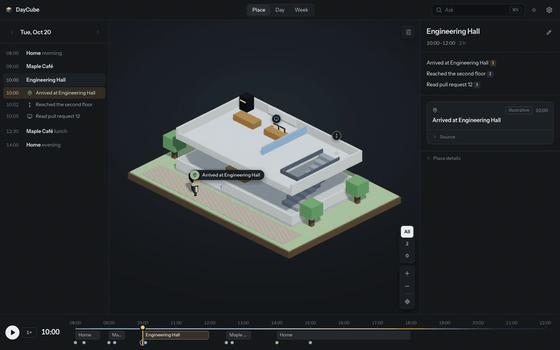
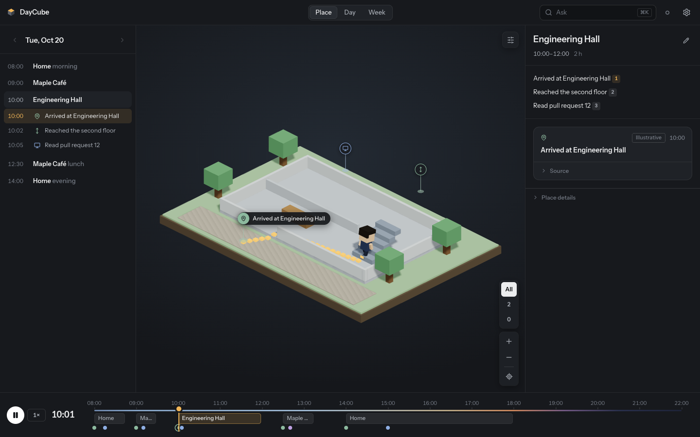
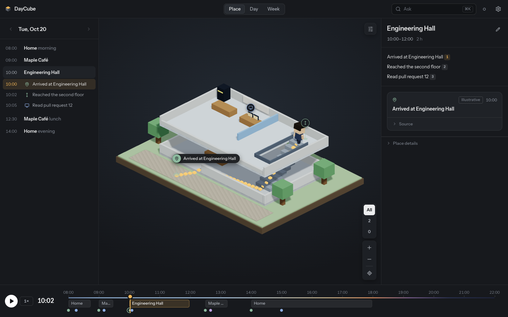
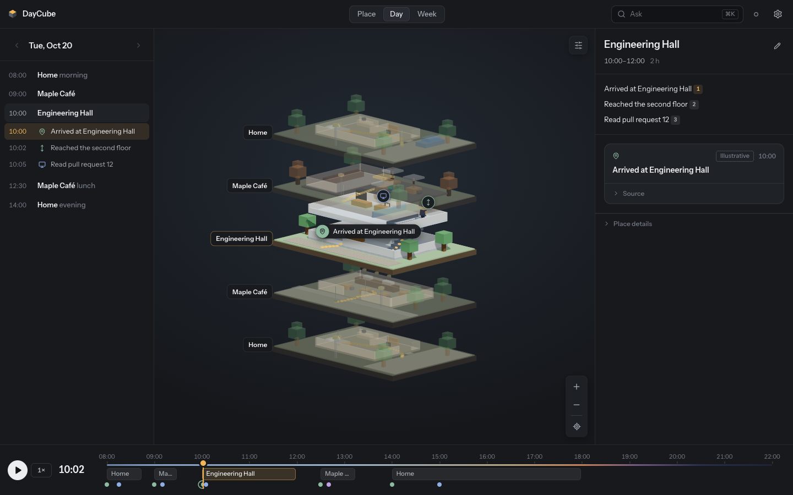
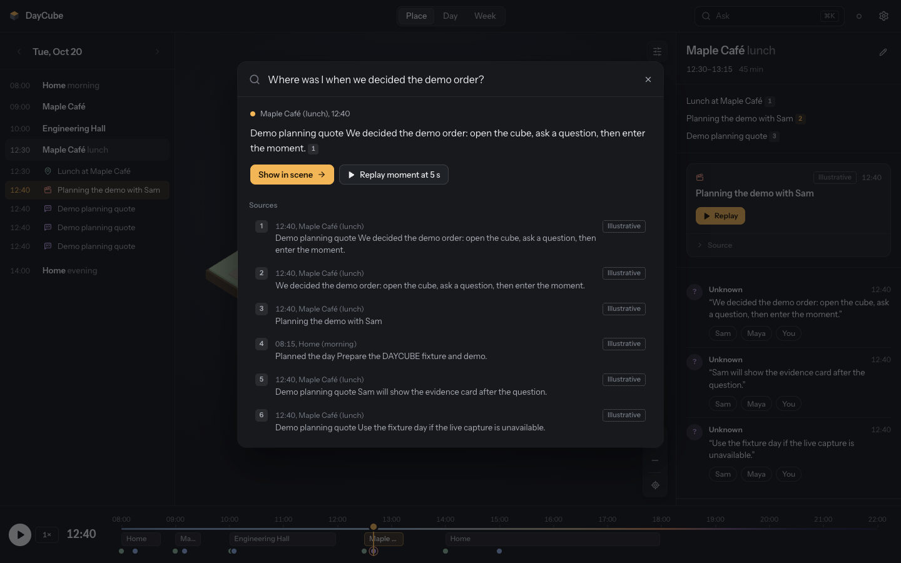

# DAYCUBE

Replay your day as a voxel world you can walk through and ask questions about. Every place you
visited becomes a small diorama, a character walks your route through it (up the stairs, to the
desk, out the door), and answers to questions cite the records they came from.



▶ [Watch the 19-second demo (MP4)](docs/media/daycube-demo.mp4): walking and climbing, the
whole day stacked, then a question answered from the local vault with sources.

| Climbing to the second floor | Arriving upstairs |
| --- | --- |
|  |  |
| **The whole day, stacked** | **Ask, with cited sources** |
|  |  |

The sample day is fictional and every scene is labelled *illustrative* in the app.

A local-first spatial memory system. This repository now contains a working **backend/API
foundation** alongside a separately maintained frontend prototype. It is not yet the complete capture/reconstruction
system described in [the technical specification](docs/daycube-technical-spec.md).

## Start locally

Prerequisites: Node 20.19+ and [uv](https://docs.astral.sh/uv/). Setup selects Python 3.11.
Core libraries are already installed in this workspace, and the synthetic sample is seeded.

```powershell
npm run setup
npm run demo:seed
npm run demo
```

- Viewer: <http://127.0.0.1:3000>
- API and interactive endpoint documentation: <http://127.0.0.1:7701/docs>
- Health/capabilities: <http://127.0.0.1:7701/health>

The frontend loads the vault day through `/api` on startup. To enable authenticated actions:

1. Open the viewer, click the gear icon (top right), then **Vault connection**.
2. Copy your token. PowerShell: `Get-Content -Raw .\vault\.token | Set-Clipboard`;
   macOS: `pbcopy < vault/.token`.
3. Paste it into the token field and click **Connect**. This also reloads the vault day.
4. Click **Rebuild search index**, then ask a question from the search field (Ctrl K).

Try “Where was I when we decided the demo order?”. Live answers quote source evidence and
select its place/time. The token is held only in page memory, so bind it again after a browser
reload. Without a bound token, Ask runs the frontend's standalone demo engine. Decorative scenes,
the moment and screen viewers, and the graph, pipeline and recall-study pages in Settings still
contain prototype data and are labelled as such in the UI; they do not mean that capture,
reconstruction or the volunteer study has run.

## Structure

```text
apps/viewer/                 React/Vite frontend with a vault/API bridge and illustrative dioramas
packages/schemas/            Canonical JSON Schemas, generated TypeScript types, Zod validators
packages/api-client/         Typed browser client with response validation
services/ingest/             FastAPI, vault storage, FTS search, adapters and tests
services/capture-win/        Opt-in browser metadata receiver and optional native-library groups
extensions/chrome/          Disabled-by-default Chrome MV3 starter
jobs/modal/                 Optional transcription/depth cloud job definitions
fixtures/sample-day/        Fictional day with 5 visits, 60 fixes and 14 events
venues/                     Fictional venue pack
eval/                       Fixture smoke evaluation and isolated synthetic CPU benchmarks
docs/                       API, architecture, dependencies, runbook and implementation status
scripts/                    Fixture generation and cross-language contract checks
vault/                      Local runtime data and token; ignored by Git
```

The frontend's rendering design is preserved under `apps/viewer`. Its bridge uses the typed API
client and converts the API's seconds-since-midnight into the renderer's decimal-hour format.

## Working now

- Atomic vault JSON/JSONL writes, schema validation and reference checks.
- Day, layer, event, skeleton, graph, moment and allowlisted media reads.
- Authenticated event writes, place renaming, speaker-map saves and index jobs.
- Rebuildable SQLite FTS5 search, extractive cited answers and SSE responses.
- Eight shared JSON Schema contracts with generated Pydantic and TypeScript models.
- GPX parser, attention helper, FFmpeg probe/audio helpers, optional integration adapters.
- A character that walks the day: routes go around furniture and through doorways, climb
  stairs step by step between floors, and cut away the floor above while it is indoors.
  Playback slows while it walks. Visits without measured indoor positions get an
  illustrative walk between the spots where their records happened.
- Python tests, JavaScript contract tests, real-browser API checks and a CI workflow.

Native capture, OCR execution, gaze calibration, visit/floor inference, raw-browser synthesis,
semantic retrieval, generative answers, deletion, splats and full moment reconstruction remain
future milestones. Unimplemented ingest stages and hour deletion return HTTP 501.
The sample moment has a synthetic transcript and **no source video/audio or GLB**.
See [implementation status](docs/implementation-status.md) for exact boundaries.

## Commands

```powershell
npm run api                   # API only, loopback port 7701
npm run dev                   # Starter viewer only, loopback port 3000
npm run demo:seed             # Seed if absent, then rebuild local index
uv run daycube validate --date 2026-10-20
uv run daycube index --date 2026-10-20
uv run daycube doctor
npm run schemas               # Regenerate Pydantic + TypeScript contracts
npm run test:api               # Drift checks, JS contracts and Python tests
npm run build                 # Build the separately maintained frontend
npm run lint:api
npm run bench:core -- --output test-results/core-current.json # Isolated synthetic CPU workloads
npx playwright install chromium
npm run test:e2e:api           # Real-browser API checks on an isolated test vault/port
npm run test:e2e:viewer        # Token binding, reindex and live Ask through the frontend
uv run python eval/score_retrieval.py
```

Make targets mirror the main commands when Make is available. On Windows the npm/uv commands
work without Make or shell activation. `npm run demo` starts both servers; Ctrl+C
stops them. Seed first with `npm run demo:seed`. Demo does not start capture, call a model or deploy a GPU job.

Optional libraries, account configuration and the remaining system dependencies are documented
in [dependencies](docs/dependencies.md) and [the runbook](docs/runbook.md).

The viewer stops rendering when idle. See [performance notes](docs/performance.md) for measured
results and regression checks. Refresh the browser after performance updates so the less costly
visual defaults take effect in an existing hot-reload session.

The [engineering standard](docs/engineering.md) applies the measured, batch-oriented approach
from the [DeepInfer reference review](docs/deepinfer-review.md) to this project's browser and
local-service workloads. The review records its scope, evidence and remaining gaps.
