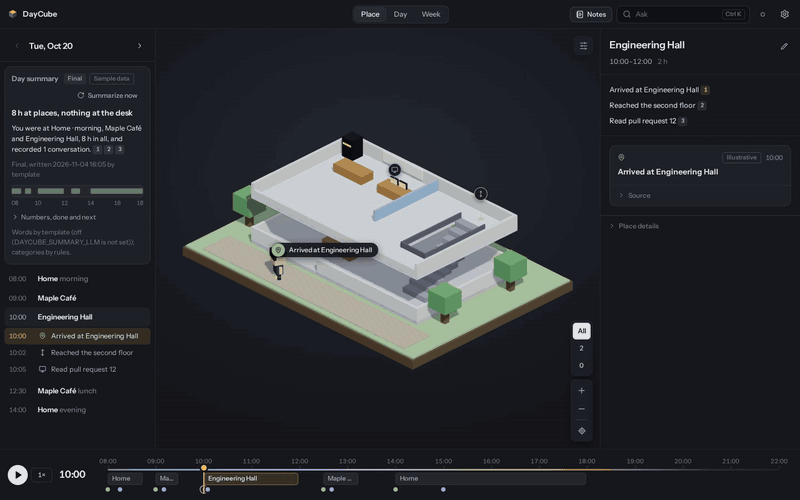
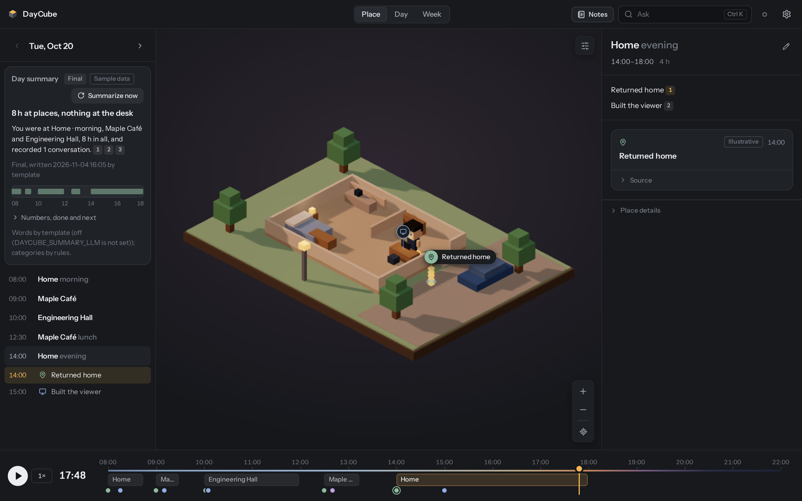
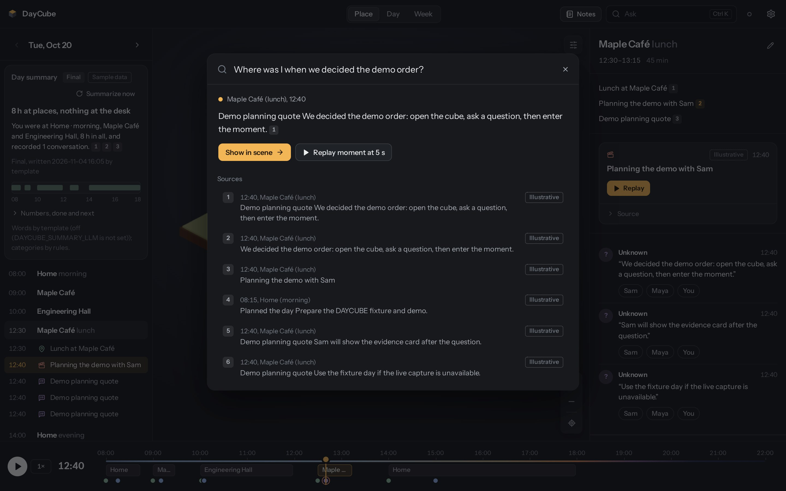
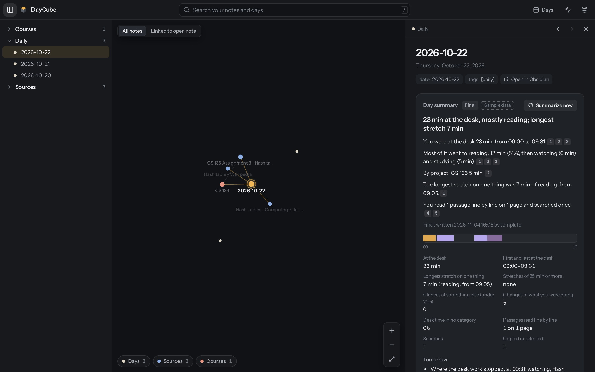
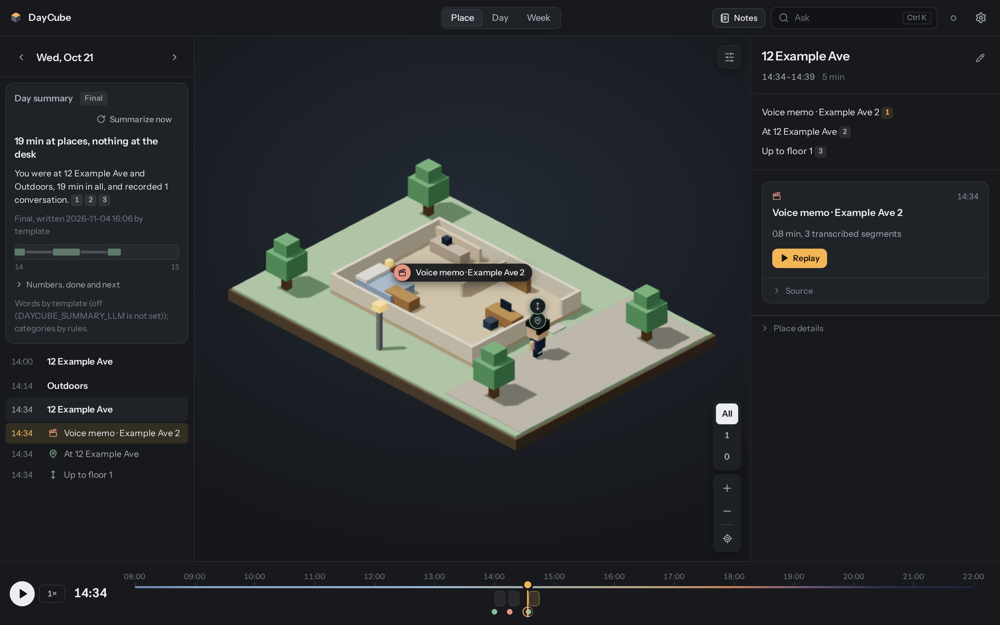
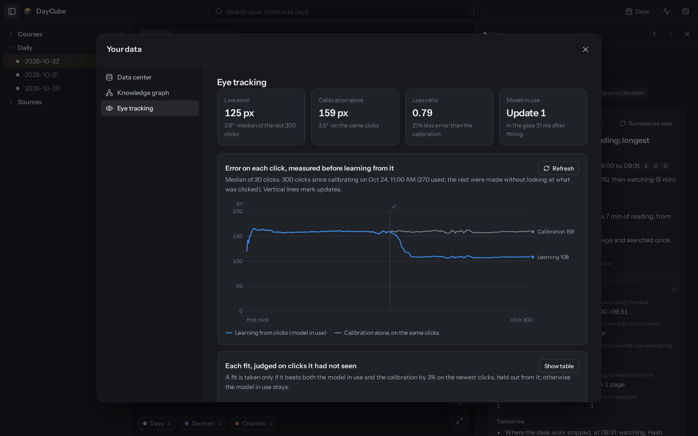
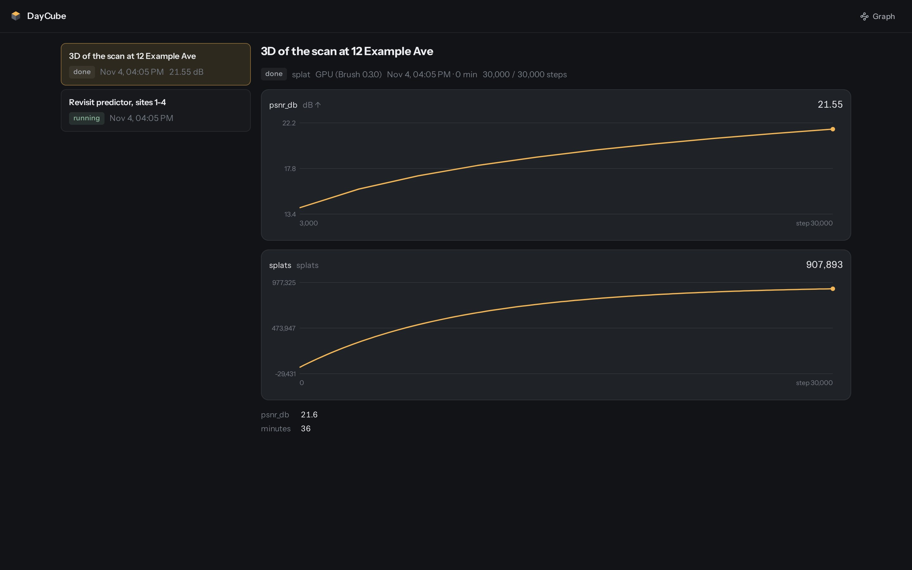

# DayCube

Your days as a world you can walk back into, search and ask about. DayCube records what you do on
your PC and phone (the places you went, what you read line by line, what was said) and keeps it as
plain files you own: a 3D day you can replay, linked Markdown notes Obsidian opens, and answers
that cite the records they came from. It runs on your own computer; nothing leaves it unless you
turn on an option that sends it (a language model, the morning summary pushed to your phone).



▶ [Watch the demo (MP4, 22 s)](docs/media/daycube-demo.mp4)

| A day in 3D, with its summary | Ask, with numbered sources |
| --- | --- |
|  |  |
| **The day's notes, beside the graph** | **A phone day: walk, floors, a voice memo** |
|  |  |
| **The eye tracker learning from clicks** | **Models trained on this PC** |
|  |  |

Every image above comes from the fictional sample data in [`fixtures/`](fixtures) (the app labels it
*Sample data* and *Illustrative*); the eye-tracking clicks and training curves are sample data
too. `npm run build && npm run media` makes them again.

## What it does

- **Days in 3D.** Each place you went becomes a scene, and a character walks your route through
  it: up the stairs to the floor the barometer measured, to the desk, out the door. LiDAR scans
  from the phone become Gaussian splats trained on your GPU ([splat](docs/splat.md)).
- **Notes and the day's summary.** What you read line by line, the pages and apps in front, your
  searches, places and conversations become linked Markdown in `vault/notes`, a folder Obsidian
  opens ([notes](docs/notes.md)). At the end of the day a summary with footnoted sources is written
  from the [day timeline](docs/timeline.md) ([review](docs/review.md)).
- **What I saw.** The day's pages and apps in the order they came to the front, a strip of when
  each was on screen, and what was read, stared at, copied and searched on each.
- **Search and Ask.** Keyword (SQLite FTS5) and meaning search (bge-small vectors) across every
  day; answers are quoted from your records with their place and time ([search](docs/search.md)).
- **Capture on Windows.** A browser extension, a webcam eye tracker that works out which line you
  are reading, reading of other apps' windows with Windows' own OCR, and counts of typing and
  mouse use with no key identities ([capture](docs/capture.md)). The eye tracker keeps learning
  from your clicks, and shows whether that helps. Any span can be deleted, from the vault and
  everything made from it ([deleting a span](docs/capture.md#deleting-a-span)).
- **Phone.** Sensor Logger (visits, walks, floors), voice memos and Stray Scanner LiDAR captures,
  dropped into the vault's inbox ([phone](docs/phone.md)). Speech becomes transcripts with who
  spoke and how, in English and Mandarin, on the GPU ([speech](docs/speech.md)).
- **Memories.** One photo becomes a small 3D scene you can step into ([memories](docs/memories.md)).
- **Training.** Models trained on this PC, each metric charted against the step
  ([training](docs/training.md)).

## The Windows app

One install with all of the above: the viewer in its own window, the vault API, capture and the
eye tracker, run from the tray and started at sign-in. No repository, Node or Python is needed on
the PC. The speech and 3D GPU packs install from the app when wanted.

Until there are releases, the installer is built by CI: open the latest run of
[DayCube for Windows](https://github.com/Zwc-11/DayCube/actions/workflows/desktop.yml) (signed in
to GitHub) and download `daycube-windows`. Every build is installed on a Windows runner and runs its
self-test there. See [the desktop app](docs/desktop.md).

## Start from source

Prerequisites: Node 20.19+ and [uv](https://docs.astral.sh/uv/) (it selects Python 3.11).

```powershell
npm run setup
npm run demo:seed      # the fictional sample vault
npm run demo           # API on 127.0.0.1:7701, viewer on http://127.0.0.1:3000
```

Actions that change the vault need its token: in the viewer, the gear icon › **Vault
connection**, paste `vault\.token` (`Get-Content -Raw .\vault\.token | Set-Clipboard`) and
**Connect**. The Windows app does this for you. Capture on your own PC:
[capture](docs/capture.md) and [the runbook](docs/runbook.md).

## Repository

```text
apps/viewer/            The interface: React, three.js (days in 3D, notes graph, Ask, settings)
apps/desktop/           The Windows app: Tauri 2 shell, bundled Python, installer (docs/desktop.md)
packages/schemas/       Twelve JSON Schema contracts; generated Pydantic, TypeScript and validators
packages/api-client/    Typed client for the API, responses validated
services/ingest/        Vault, API (FastAPI), search, notes, timeline and review, phone import, 3D jobs
services/capture-win/   Capture receiver: browser and screen records, gaze, input counts, jobs
services/gaze/          Webcam eye tracker (EyeTrax), its own environment
services/speech/        Transcripts, speakers and emotion on the GPU, its own environment
services/recon/         Photo and scan to 3D (SHARP, COLMAP), its own environment
extensions/chrome/      DayCube Capture extension (Opera, Chrome, Edge)
fixtures/               Fictional sample day, phone day and capture morning
eval/                   Simulations, benchmarks and their recorded results
docs/                   Every part in detail; start with architecture.md
```

## Status and limits

- Built and used on Windows; capture and the app are Windows-first.
- Ask quotes your records; it does not generate free-form answers. The end-of-day summary is
  written by a template unless you turn on a model (`DAYCUBE_SUMMARY_LLM`).
- Memories use Apple's SHARP, whose research licence allows evaluation only.
- Speech and 3D need an NVIDIA GPU (an RTX 5070 here).

Exact boundaries: [implementation status](docs/implementation-status.md).

## Commands

```powershell
npm run check                  # lint, Python and contract tests, eye tracker, extension, build
npm run test:e2e:viewer        # the interface in a real browser, on the sample vault
npm run schemas                # regenerate the contracts after changing a schema
uv run daycube index --all     # rebuild the search database from the vault's files
uv run daycube doctor          # check the vault
.\capture doctor               # check capture on this PC
npm run media                  # remake the README's screenshots and video (after npm run build)
```

Engineering: measured changes only, recorded with their benchmarks
([engineering](docs/engineering.md), [efficiency](docs/efficiency-review.md),
[performance](docs/performance.md)).
