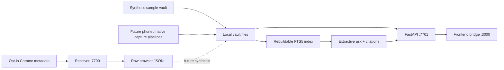

# Architecture

The vault is the integration contract. Ingest writes validated files, the API derives viewer
layers from those files, and the viewer never imports pipeline internals. SQLite is disposable.

Solid arrows are implemented. Dashed paths are planned. The default demo uses fictional fixture
data, local keyword search and no external model calls. Source files are never reconstructed
from an index.

## Contracts and time

Eight canonical draft-2020-12 JSON Schemas live in `packages/schemas`. Python uses generated
Pydantic models for request typing and jsonschema for full validation (including conditional
event extras). TypeScript types are generated from the same files. Zod wraps Ajv validators
so the browser enforces the full same JSON Schema rather than a partial conversion.
`npm run schemas:check` detects generated-file drift.

Files retain ISO 8601 instants with offsets. API layer/event `tod` fields are local wall-clock
seconds since midnight, computed with the day's IANA timezone; they are not decimal hours.
The ISO timestamp remains available to disambiguate repeated clock times at DST transitions.
Unknown positions/floors stay null. Coordinates use x east, y north, z up. Stage geometry is
explicitly illustrative. A captured event may also have an independent `position_fidelity`.
Visit ids are day-local visit identities, distinct for repeat visits; stable cross-day place
identity and relative-to-actual floor anchoring are still design tasks.

## Storage and concurrency

The API uses one worker process with an in-process writer lock. Atomic file replacement avoids
partial reads of individual files. Multi-file operations are not a transactional filesystem;
cross-process writers, crash recovery and live capture synthesis still need coordination.
Index rebuilds close all SQLite handles before atomic replacement for Windows compatibility.
Source mtimes/sizes and renamed place labels invalidate the index automatically.
Job status is bounded to 100 in-memory jobs and expires on server restart.

## External boundaries

These adapters are opt-in and not part of the default `/ask` route:

- Overpass sends rounded location coordinates to an OSM endpoint and caches building responses.
- FastEmbed downloads model weights on first explicit adapter construction, then embeds locally.
- Anthropic sends questions/evidence only when its adapter is explicitly called. Its phrasing
  method produces candidate wording; a semantic verifier is required before product use.
- Modal uploads the supplied audio/frames only on explicit remote invocation. The job definitions
  have not been deployed or GPU-tested. Their output is not automatically ingested.

No API keys are shipped or exposed to the viewer. Model IDs are configured from the user's
available account models; the speculative model IDs in the source spec are not hardcoded.

## Access boundaries

Both API services and the Vite server bind to loopback. All mutation/action routes require the
vault bearer token. Read endpoints are unauthenticated, as in the spec: this is a single-user
local-development server, not a multi-user deployment. Do not bind it to a public interface.
Media serving is confined to the selected day and an extension allowlist; `.token`, JSON and
SQLite files are never served through it. CORS permits only configured local/extension origins.
Tokens and personal data folders are ignored by Git.

The browser receiver and extension are explicit opt-ins. Native screenshots, webcam access,
tray controls, consent enforcement and full deletion are not implemented. The current build
is intended for synthetic/test data until those privacy controls are complete.
