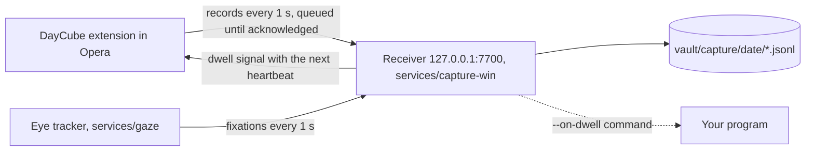

# Capture: browser and gaze on your PC

From sign-in to shutdown, three pieces record what you do in the browser and where you look:



- **The extension** reports pages, focus, searches, clicks, selections, media, and snapshots of
  the text on screen with where the viewport sits on the monitor.
- **The eye tracker** turns webcam frames into fixations with EyeTrax (MIT). Frames stay in
  memory; only fixations leave the process. It runs in its own environment because EyeTrax
  needs numpy<2 and the rest of DayCube needs numpy>=2.
- **The receiver** writes the logs, decides which paragraph each fixation belongs to, and detects
  dwells. It learns the tracker's live error from clicks (people look at what they click) and
  corrects for it. It starts the eye tracker and restarts it if it stops.

Nothing goes over the network: the receiver listens on 127.0.0.1 only, and the extension can
reach no other host.

## Set up on Windows

From the repository folder, in PowerShell:

```powershell
uv sync --project services/capture-win
uv sync --project services/gaze

# 1. The webcam: frame rate and how often a face is found. Aim for 15+ frames/s and 90%+.
uv run --project services/gaze python -m gaze check

# 2. Calibrate: 13 dots, about 30 s. Sit as you normally do, about an arm's length away.
uv run --project services/gaze python -m gaze calibrate

# 3. Start everything now and at every sign-in (no administrator rights needed).
uv run --project services/capture-win python -m capture install-autostart
```

Then in Opera:

1. Open `opera://extensions`, turn on **Developer mode**, choose **Load unpacked** and pick the
   `extensions/chrome` folder.
2. On the extension's card, turn on **Allow access to search page results**. Opera keeps
   extensions off search result pages unless this is on.
3. Open the extension's options (right-click its toolbar button, then **Options**), paste the
   contents of `vault\.token`, tick **Record my browsing**, and save. The **Right now** panel
   should show the receiver and the eye tracker running.

Optional: copy the history Opera already kept (about 90 days) into the vault:

```powershell
uv run --project services/capture-win python -m capture import-history
```

After pulling a new version, reload the extension at `opera://extensions` and restart the
receiver (sign out and in, or end its `pythonw.exe` in Task Manager and run
`python -m capture install-autostart` again), so the extension, receiver and tracker run the same
code. A newer tracker or extension still works with an older receiver: fields it does not know
are ignored.

Recalibrate when your seat, lighting or monitor changes (`python -m gaze calibrate`). It pauses
recording for the half minute it takes, which frees the webcam, and the receiver restarts the
tracker with the new calibration.

### Processing rate and live checks

The tracker now targets **30 processed frames/s** by default, including when started by the
receiver at sign-in. The camera keeps its existing mode: this setting does not request 1080p,
change calibration geometry or create a faster hardware capture mode. A manual override is:

```powershell
uv run --project services/gaze python -m gaze track --fps 15
```

`/status` reports `gaze.target_fps` separately from the rolling measured `gaze.fps` and face
detection fraction (`gaze.face`, from 0 to 1). Refresh the extension's options page after updating:
**Right now** shows measured/target FPS, face percentage and calibration error. For example,
`29.8/30 fps` means a measured 29.8 with a target of 30; it does not round the measurement up.
Pausing hides old active telemetry, and resuming waits for a fresh tracker report.

Collect a rate report without opening the camera, reading recordings or changing pause state:

```powershell
uv run python eval/profile_gaze.py --seconds 15 --output test-results/gaze-rate.json
```

The report samples status only. Its rate values share the tracker's rolling ten-second window,
so consecutive samples are correlated. Allow ten seconds after startup for that window to settle.
Processing rate and face detection establish that the tracker is working on frames. Whether gaze
lands on the right paragraphs is measured from ordinary use, below.

### Checking it without a test

```powershell
uv run --project services/capture-win python -m capture doctor
```

prints one line per check, from what the services recorded while you used the computer: receiver,
extension, frame rate, face detection, **fixations** (the share of gaze that became fixations, and
the gaze noise), calibration error, **live accuracy**, today's logs, dwells and the sign-in entry.
It exits with code 1 when a check fails.

Live accuracy comes from clicks. The eyes are on a link or button when it is clicked, so each mouse
click with a fixation around it measures how far off the tracker is at that moment and place
(keyboard clicks have no position and are not used). After five clicks the receiver reports the
median error before and after its correction (each click predicted from the clicks before it),
uses it as the gaze error it allows for while the newest click is under 10 minutes old, and shows
it in the extension's **Right now** panel (`58 px now (7 clicks)`). A recalibration starts the
clicks over. A live error above the calibration limit means: recalibrate
from your usual seat. Every 10 minutes while gaze arrives, the same figures go to
`vault/capture/<date>/health.jsonl`, so a session can be judged afterwards.

## Everyday use

| To | Do |
| --- | --- |
| Pause everything, including the webcam | Click the toolbar button or press `Alt+Shift+D` (works once the token is saved, even with browser recording off). The badge reads `II`. The webcam is released within about a second |
| Resume | The same again. The badge reads `REC` |
| See whether it works | The extension's options page, **Right now**; or `http://127.0.0.1:7700/status` |
| Stop starting at sign-in | `python -m capture uninstall-autostart`, or turn it off in Task Manager > Startup apps |
| Read the logs | `vault\logs\capture.log` and `vault\logs\gaze.log` |

A pause is remembered across restarts: the receiver keeps it in `vault/capture/paused` until you
resume, and logs every pause and resume in `vault/capture/pauses.jsonl`. A pause made while the
receiver was unreachable is retried every 3 seconds for a minute, then every 30 seconds while
Opera is open. If Opera closes before the receiver hears of it, the pause applies at the next
start of Opera with the receiver running; until then the eye tracker keeps recording.

The webcam turns on only after the receiver has confirmed that it is running and not paused,
and turns off within about 5 seconds of the receiver stopping or a pause. It is also released,
and nothing is recorded, while the session is locked, while another app uses the camera (a
video call), and when you are away: no keyboard or mouse input for 5 minutes and no face for
the last minute. Reading without touching anything keeps tracking. When the primary monitor is
not the calibrated one (a laptop undocked, a monitor off), tracking stops and is retried every
minute.

## Dwells: when your eyes stay too long

A *dwell* is a run of time on one block of text (a paragraph, heading, list item or cell).
Looking elsewhere for up to 2.5 seconds does not end it; a gap in gaze of 2 seconds, a tab switch
or a navigation to another page does (an address change within the page, such as a section link,
does not). Blinks and saccades between fixations count as looking. A run becomes a dwell when its
time reaches both:

- 8 seconds (`--dwell-seconds`), and
- twice the time the block takes to read at 238 words a minute (`--dwell-factor`), the average
  adult silent reading rate for English non-fiction (Brysbaert 2019, a meta-analysis of 190
  studies).

Reading a long paragraph at normal speed is therefore not a dwell. Reading it at under half
speed, re-reading it, or staring at a short line is. A dwell also needs a block the tracker can
single out at its current error: with a coarse calibration, a heading 20 px above a paragraph is a
guess between the two, and no dwell is reported on it.

Each dwell writes a `start` record when it is detected and an `end` record when it ends, with
the page, the block's text, fixation time and reading time. What happens at `start` is up to you:

| Action | Where to set it |
| --- | --- |
| Only record it (default) | Extension options |
| A notification with the passage | Extension options |
| A thin bar beside the paragraph, fading after 4 s. It is an element added to the page, so the site's scripts can see it | Extension options |
| Any program: it receives the dwell record as JSON on stdin | `python -m capture install-autostart --on-dwell "C:\path\to\program.exe --flag"` |

The bar and the notification arrive with the page's next heartbeat, so up to 5 seconds after
the dwell is detected. The program runs at once; one runs at a time.

## What is recorded

`vault/capture/<local date>/`, one JSON object per line:

| File | Records |
| --- | --- |
| `browser.jsonl` | `page` (address, how it was reached: link, typed, reload, form submit, back/forward; address changes that only move to a section are left out), `title`, `focus` (tab in front; none when the browser loses focus; no address for an excluded page), `idle` (active, idle after 60 s, locked), `search` (engine and query from result-page addresses), `click` (label, where it landed on the page, and the link address unless it points to an excluded domain), `selection` (selected or copied text), `media` (play, pause, end, with position) |
| `blocks.jsonl` | The text blocks on screen (up to 150) with their rectangles, and where the viewport is on the monitor. A block's text is sent once per page load, and again if queued text was dropped; later snapshots carry only positions |
| `gaze.jsonl` | Fixations as fractions of the monitor, with the page point (corrected by clicks), the block the eyes were most likely on and its probability `p` |
| `attention.jsonl` | Dwell `start` and `end` records |
| `health.jsonl` | Every 10 minutes while tracking: the tracker's state (frame rate, face, fixation share, noise) and the live accuracy from clicks |
| `history.jsonl` | Visits imported from Opera's history |

Not recorded:

- private windows, and domains excluded in the extension options (subdomains included);
- the text, clicks, selections and media of a page while it, a frame in it (an embedded sign-in
  or payment form) or an open shadow root shows a password field. The page's address and title
  are still recorded;
- anything typed: fields, editable areas, and code editors that draw typed text in plain
  elements (Monaco, CodeMirror, Ace);
- anything while paused.

`import-history` leaves out the same things the extension would: the extension's excluded
domains (mirrored to `vault/capture/exclusions.json`), the domains, URL patterns and title
patterns in `services/capture-win/config/exclude.yaml`, and visits made while recording was
paused. It merges Opera Stable and Opera GX, and each run mirrors the browser's current history:
a day whose visits are all gone loses its file.

Every record has an id. The extension keeps records in its storage until the receiver
acknowledges them (up to 5,000; the oldest text snapshots are dropped first). The receiver
ignores an id it has already stored, and stores an id only once its record is written, so a
resend after a lost reply or a failed write is stored once per receiver run. Records older than
24 hours are refused. After a restart the receiver reloads block texts from today's and
yesterday's snapshots, so dwells on pages already open still know their text.

## How gaze is placed on a page

1. The tracker predicts a screen point per frame (EyeTrax ridge regression on MediaPipe eye
   landmarks), smooths it with a One Euro filter, and groups samples into fixations (I-DT, at
   least 0.1 s, split at 1 s so a long stare is reported while it lasts). The dispersion
   threshold starts at 6% of the screen width and rises with the gaze noise measured over the
   last 8 seconds, so a noisy session is not broken into pieces too short to keep. The tracker
   reports the share of gaze that became fixations (`coverage`) and the noise (`noise_px`).
2. The extension reports where the viewport is on the monitor: measured from two mouse events
   (screen point minus page point, and the page zoom from their spacing), otherwise estimated
   from the window's outer and inner sizes.
3. The receiver subtracts the offset learned from recent clicks, converts the fixation to page
   coordinates, and corrects for scrolling since the last snapshot.
4. It does not pick the block under the point: webcam error is larger than the space between
   paragraphs. A filter over "on block b" and "on nothing" scores each block by how likely the
   tracker was to report this point if the eyes were anywhere in it (the block blurred by the
   current gaze error), and assumes the eyes tend to stay where they were. After each fixation it
   knows how likely each block is; the block that leads is the one in `gaze.jsonl`, and the time
   it leads is what a dwell counts. Details and parameters: `services/capture-win/capture/attention.py`.

The receiver clears its front page on focus loss. Returning to a tab or window therefore sends
a fresh block-position snapshot even when the page has not changed. Block ids remain stable;
already acknowledged text is not duplicated. Reload the unpacked extension and refresh open
pages after updating the reporter script.

## Limits

- **Accuracy.** Webcam gaze is good to roughly 2-4 degrees: paragraphs, not words. Calibration
  reports the median error on four held-out targets and refuses to track above 120 px at 1920 px
  wide (scaled to your screen width; 160 px on a 2560 px monitor). Glasses, backlight and head
  movement make it worse; the live accuracy from clicks shows when, and `doctor` says to
  recalibrate.
- **One monitor.** Gaze is calibrated on the primary monitor. Pages in windows on other monitors
  are recorded, but gaze is not placed on them.
- **Windows acceptance.** The webcam, calibration, live receiver, Opera settings and browsing
  records were checked on the Windows PC ([record](capture-windows-check.md)). The paragraph test
  and the reading tests are now simulated end to end (below) instead of being run by hand; on the
  PC, `python -m capture doctor` judges a session from ordinary use. Lock, video-call camera
  handoff and sign-in are covered by the tracker's tests with a scripted computer; the Windows
  calls themselves (`OpenInputDesktop`, the camera privacy records, the `Run` key) are not.
- **Browser only.** Other apps, screenshots and OCR are not captured yet; nor is there a tray
  icon. The toolbar badge and Windows' own camera indicator show that recording is on.
- **No synthesis yet.** The logs are not yet turned into day events in the viewer.

## Size

Fixations are about 260 bytes each with the block and its probability; an 8-hour simulated day
(`eval/capture_soak.py`, 3 fixations a second) wrote 24 MB of `gaze.jsonl`, 4.9 MB of text
snapshots and 0.6 MB of browser records before compression. Text snapshots depend on how much you
scroll. `daycube compact` compresses the capture logs of finished days with zstd, for days that
also have a vault day folder; capture-only days are not compacted yet.

## Tests

```powershell
uv run pytest services/ingest/tests/test_capture.py services/ingest/tests/test_attention.py services/ingest/tests/test_anchors.py services/ingest/tests/test_capture_tools.py
cd services/gaze; uv run pytest
npm run test:extension   # Node unit tests, then the extension in Chromium against a scratch vault
# Reporter lifecycle only: synthetic transport, safe while the live receiver is running.
npx playwright test --config playwright.extension.config.ts reporter.e2e.spec.ts
```

`gaze.e2e.spec.ts` is the paragraph test without a person: example.com at 200% zoom (set with
`chrome.tabs.setZoom`) in Chromium with the extension, the real receiver, and the real tracker
loop fed by simulated eyes staring at the paragraph through the recalibrated session's error
model, in real time for 20 s. It checks that the reporter measured the zoom, that the paragraph is
where the browser says it is, that the dwell fires on it and the bar appears, that a 5 s glance
does not fire, and that clicks carry their position. Headless Chromium needs the full browser
(`DAYCUBE_CHROMIUM=<path to chrome>`), not the headless shell, for extensions.

A day of capture through the receiver, at the live rates, takes about four minutes:

```powershell
uv run python eval/capture_soak.py --hours 8 --output eval/results/capture-soak.json
```

On 8 simulated hours (28,800 browser and 28,800 gaze batches, 91,076 fixations) every record was
logged once, none malformed, the receiver's id, text and click caches stayed under their caps,
and the median request took 3.6 ms (browser) and 5.0 ms (gaze), 0.5-0.9 ms more in the last
tenth of the day than in the first. The tracker's smoother and fixation detector take 20 µs a
frame.

## Simulation

`eval/gaze_sim.py` runs the tracker loop and the receiver's attention code against simulated
eyes and webcam error, 100 sessions per row, on a 2560 x 1440 monitor at 100% and 125% Windows
scaling. The error model is fitted to the held-out error the tracker reports, per frame: a
calibration bias that varies over the screen (an offset, a linear term and broad bumps), head
drift since calibration, correlated frame jitter, landmark failures and blinks. Clicks in the
simulation land within about 15 CSS px of where the eyes are, and one in seven is made without
looking. The attention parameters were chosen on seeds 0-39; the table uses seeds 1000-1099. Page layouts are measured by the extension's reporter in
Chromium (`eval/measure_pages.mjs`).

```powershell
uv run python eval/gaze_sim.py --compare 80e2d6b --output eval/results/gaze-sim.json
```

Pass rate per case, revision `80e2d6b` (before) → this version, by calibration error (median
held-out, per frame: the first calibration on the Windows PC, the recalibration, a good webcam
session) and Windows scaling. A dwell case passes when a dwell fires on the intended block and on
no other; a no-dwell case passes when none fires.

| Case | Expect | 183 px, 100% | 183 px, 125% | 69 px, 100% | 69 px, 125% | 40 px, 100% | 40 px, 125% |
| --- | --- | ---: | ---: | ---: | ---: | ---: | ---: |
| stare 20 s, 200% zoom | dwell on target | 0% → **87%** | 0% → **90%** | 82% → **100%** | 93% → **100%** | 97% → **100%** | 100% → **100%** |
| stare 20 s, 200% zoom, after 6 clicks | dwell on target | 0% → **94%** | 0% → **94%** | 82% → **100%** | 88% → **99%** | 94% → **99%** | 98% → **100%** |
| stare 20 s, 100% zoom | dwell on target | 0% → **71%** | 0% → **74%** | 39% → **89%** | 56% → **94%** | 72% → **99%** | 84% → **99%** |
| look away 1.5 s mid-stare | dwell on target | 0% → **83%** | 0% → **87%** | 75% → **100%** | 87% → **100%** | 95% → **100%** | 100% → **100%** |
| re-read a paragraph 3 times | dwell on target | 0% → **6%** | 0% → **17%** | 26% → **45%** | 43% → **56%** | 54% → **80%** | 69% → **88%** |
| glance 5 s | no dwell | 100% → **100%** | 100% → **100%** | 100% → **100%** | 100% → **100%** | 100% → **100%** | 100% → **100%** |
| tab switch mid-stare | no dwell | 100% → **100%** | 100% → **100%** | 100% → **100%** | 100% → **100%** | 100% → **100%** | 100% → **100%** |
| read an article | no dwell | 100% → **100%** | 100% → **97%** | 100% → **100%** | 100% → **100%** | 100% → **100%** | 100% → **100%** |
| slow read under a heading | no dwell | 100% → **100%** | 100% → **100%** | 100% → **100%** | 100% → **100%** | 100% → **100%** | 100% → **100%** |

| Share of tracked time in fixations | | 34% → **80%** | 33% → **80%** | 83% → **91%** | 82% → **91%** | 88% → **90%** | 87% → **89%** |

- **Why the Windows stares failed.** With the first calibration's error, the fixation detector
  kept a third of tracked time (its threshold was fixed at 6% of the screen width; noisier gaze
  broke a steady look into pieces too short to keep), and the receiver counted only fixations
  inside the paragraph's rectangle, ending the run after 1 s outside it. None of 100 simulated
  stares became a dwell, as on the PC. The old code passed 82-93% with the recalibrated error.
- **Clicks** matter most when the calibration has drifted: six clicks before the stare take the
  coarse calibration from 87-90% to 94%.
- **Re-reading** a paragraph three times is the weakest case: its first and last lines sit within
  the gaze error of the neighbouring blocks, and the filter is deliberately quicker to move on
  once a paragraph's reading time has passed, which is what keeps normal reading from being
  flagged.
- The simulation measures the code, not the person: the error model, the stare (fixations of
  about 0.45 s anywhere in the middle of the paragraph) and reading (one fixation per 1.2 words
  at 200-280 wpm) are models. `python -m capture doctor` and `health.jsonl` measure real sessions.
