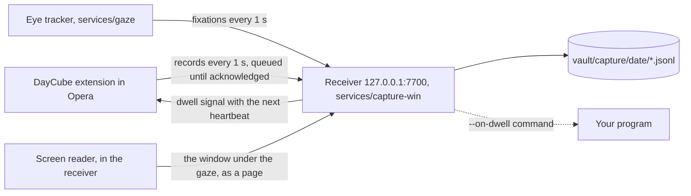

# Capture: browser and gaze on your PC

From sign-in to shutdown, three pieces record what you do on the computer and where you look:



- **The extension** reports pages, focus, searches, clicks, selections, media, and snapshots of
  the text on screen with where the viewport sits on the monitor.
- **The eye tracker** turns webcam frames into fixations with a gaze model that follows head
  movement ([below](#when-your-head-moves)), on MediaPipe face landmarks; EyeTrax (MIT) runs the
  camera and the calibration screens. Frames stay in memory; only fixations leave the process,
  and, while the gaze ring is on screen, the current gaze point every frame (shown, never
  stored). It runs in its own environment because EyeTrax needs numpy<2 and the rest of DayCube
  needs numpy>=2.
- **The receiver** writes the logs, decides which paragraph each fixation belongs to and which
  line is being read, and detects dwells. It learns the tracker's live error from clicks (people look at what they click) and
  corrects for it. It starts the eye tracker and restarts it if it stops.
- **The screen reader** (in the receiver, Windows) reads the text of the window your eyes are on
  in any other app, with Windows' own OCR, and hands it to the receiver as a page, so reading,
  lines and dwells work in an editor, a PDF reader or a chat app as on a web page
  ([Reading other apps](#reading-other-apps)). It also logs which app is in front.

Nothing goes over the network: the receiver listens on 127.0.0.1 only, and the extension can
reach no other host.

## Set up on Windows

From the repository folder, in PowerShell:

```powershell
uv sync --project services/capture-win
uv sync --project services/gaze

# 1. The webcam: frame rate and how often a face is found. Aim for 15+ frames/s and 90%+.
uv run --project services/gaze python -m gaze check

# 2. Calibrate: 13 dots with your head still, then it asks you to move your head (lean back or
#    move a hand's width to one side) for 4 more; about 45 s. Sit as you normally do, about an
#    arm's length away. It prints how each gaze model did and keeps the best.
uv run --project services/gaze python -m gaze calibrate

# 3. Start everything now and at every sign-in (no administrator rights needed).
uv run --project services/capture-win python -m capture install-autostart
```

Then in Opera:

1. Open `opera://extensions`, turn on **Developer mode**, choose **Load unpacked** and pick the
   `extensions/chrome` folder.
2. On the extension's card, turn on **Allow access to search page results**. Opera keeps
   extensions off search result pages unless this is on.
3. Open the extension's options (right-click its toolbar button, then **Options**), paste the
   contents of `vault\.token`, tick **Record my browsing**, and save. The **Right now** panel
   should show the receiver and the eye tracker running.

Optional: copy the history Opera already kept (about 90 days) into the vault:

```powershell
uv run --project services/capture-win python -m capture import-history
```

After pulling a new version, reload the extension at `opera://extensions` (its card shows the
version: 0.8.1 now; 0.5.0 or later puts its page script into tabs already open, so they need no refresh;
before 0.5.0, refresh them), and restart the receiver
(sign out and in, or end its `pythonw.exe` and `python.exe` processes in Task Manager and run
`python -m capture install-autostart` again), so the extension, receiver and tracker run the same
code; `python -m capture doctor` reports a receiver still running older code. A newer tracker or
extension still works with an older receiver: fields it does not know are ignored.

Version 0.8.1 limits the page reporter's text/layout caches to 5,000 blocks. Returning to an
evicted block keeps its ID and resends its text and lines. The receiver's line decoder follows
its layout cache's evictions too. Extension deliveries share one in-flight request and store
pending records before sending; the receiver request and JSON response have a five-second
deadline. Failed responses keep the queue for retry. These changes do not alter gaze calibration
or confidence; [measurements and limits](review-2026-10-24.md) use synthetic data.

Recalibrate when your lighting, webcam or monitor changes, or the glasses you wear
(`python -m gaze calibrate`); with the head-aware model, moving your chair or head does not need it. It pauses recording for
the half minute it takes, which frees the webcam, and the receiver restarts the tracker with the
new calibration. When EyeTrax's ridge is in use (an older calibration, or the one that scored
best), it is right only while your head stays where it was; `doctor` says so.

### The gaze ring over every window

With **Show where I am looking and the line I am reading** on (extension options, or
`python -m capture ring on|off`; the receiver remembers it in `vault/capture/display.json`), the
eye tracker draws the red ring itself, over every window and app on the calibrated monitor
(`services/gaze/gaze/overlay.py`):

| | Ring inside the page (before, and off Windows) | Ring drawn by the tracker (Windows) |
| --- | --- | --- |
| Where | the active tab of a browser window on the calibrated monitor, only on http(s) pages the extension runs in | everywhere on that monitor: every Opera window and tab, Opera's own pages, other apps, the desktop |
| How often it moves | when the page asks for the point, about 30 times a second | every display frame (60, 120 or 144 Hz), between gaze points |
| Path of a point | tracker, HTTP to the receiver, page request through the service worker, page | tracker thread to overlay thread, in memory |
| Delay it adds | polling (up to 33 ms) plus easing (25 ms) plus the HTTP hops | one sample interval: 33 ms at 30 fps, 17 ms at 60 |

The window is a layered, click-through, always-on-top tool window (it never takes focus, is not
in the taskbar or Alt-Tab, and claims the top again every second) left out of screenshots,
recordings and screen sharing (`WDA_EXCLUDEFROMCAPTURE`), so DayCube's own screen capture never
reads it. Its thread waits for the compositor (`DwmFlush`) and moves the window once a frame,
showing the gaze one sample interval ago interpolated between the two points around it, so
motion is continuous at any refresh rate. The click correction the receiver learns is sent to
the tracker as a 9 x 5 grid with each `/gaze` reply and applied to the ring, as the receiver
applies it to fixations. The ring fades when no point comes for 0.6 s, goes after 4 s, and waits
whole and dashed at the monitor's edge while the gaze is off it. Pages draw no ring of their own
while the tracker's is up (`/live` answers `"native": true`); if its window cannot open, `doctor`
says why and pages draw the ring as before. The blue line marker stays in the page: it marks a
line of the page's own text.

`doctor` reports it (`gaze ring: drawn over every window: 143 frames/s on a 144 Hz display,
moving 140 times/s between 60 gaze points/s`). Without the tracker or a camera,
`uv run --project services/gaze python -m gaze.overlay` circles the ring for 3 s and prints the
frames drawn per second. Checked in Wine 9 on a virtual display: the window opens, draws the ring
and its dashed variant, and moves on every one of 60 frames a second from 30 points a second.

### A steady ring

The ring and the live point no longer follow the One Euro filter that fixations are found in: at
webcam noise its speed adaptation reads jitter as movement, and the ring shook ("too
sensitive"). Feit et al. (CHI 2017, 80 people on two trackers) found the same of One Euro for
gaze cursors, and that the best filters keep a fixation estimate with saccade detection and
outlier correction; Spakov (ETRA 2012) and Tobii's zero-delay filter (US11915521B2) work the same
way. `services/gaze/gaze/stabilize.py`:

- **Resting:** each sample pulls the estimate by `max(1/n, 1 - exp(-dt/0.2 s))`: the plain mean of
  a fixation's first samples, then an exponential average, so reading along a line glides.
- **A far jump:** a sample more than 4.5 times the noise away (within 1-12% of the screen width) is
  held back; a single one is a bad frame and ignored; two in a row that agree are a saccade, and
  the ring jumps to them.
- **A near jump** (the next button): the median of the last 4, 6 or 8 samples farther than 3 times
  what such a median usually is, when they are one look, moves the estimate there.
- The noise is measured as it goes (median distances tracked with multiplicative steps over 3 s),
  so a sharper calibration gets a quicker ring. A blink resumes from one frame's pull; a gap or a
  long blink starts over.

On simulated webcam gaze with the PC's error model (`eval/ring_filter.py`, 10 two-minute sessions
of reading, looking around and nearby targets; `eval/results/ring-filter.json`), measured at
240 Hz the way the overlay draws it:

| | One Euro (before), 30 fps | ring filter, 30 fps | One Euro, 60 fps | ring filter, 60 fps |
| --- | --- | --- | --- | --- |
| shake while resting (RMS per display frame) | 6.0 px | **3.3 px** | 8.3 px | **3.6 px** |
| wander within a fixation (RMS) | 38 px | **20 px** | 38 px | **19 px** |
| to 70% of a jump of 300+ px (median) | 104 ms | 123 ms | 79 ms | 85 ms |
| to 70% of a jump of 120-300 px | 119 ms | 182 ms | 80 ms | 94 ms |
| median distance from the eyes | 103 px | 116 px | 96 px | 113 px |
| cost per sample | 2 us | 7 us | 2 us | 7 us |

The ring is half as jittery; the price is one more frame before a far jump (the second sample
that confirms it is not a bad frame) and about 60 ms on near ones at 30 fps, both a third of
that at 60 fps (`python -m gaze calibrate --fps 60` where the webcam offers it). Fixations are
still found in the One Euro output, whose thresholds the detector was measured on.

### Processing rate and live checks

The gaze rate is the webcam's frame rate: one gaze point per frame. Calibration asks the webcam
for **60 frames/s** (`gaze/camera.py`): it tries MJPG at 1280 x 720 and 640 x 480 with Media
Foundation, then DirectShow, times the frames each really delivers, keeps the first mode giving at
least 51 a second, and saves it in `gaze.json` (`camera_mode`). Tracking opens the webcam in that
mode, because the gaze model is fitted to its image, and targets its rate. A webcam without a 60
fps mode, or a calibration saved before this, keeps the default mode at 30. `doctor` prints the
rate frames really arrive at (`webcam: 60 frames/s in 1280x720 MJPG 60 fps`), and how to get 60
when it is 30. At 60 frames/s a frame has 16.7 ms: the face model takes about 15 ms on a 2-core
cloud machine and less on a desktop processor (`doctor`'s **frame time** shows it). Overrides:

```powershell
uv run --project services/gaze python -m gaze calibrate --fps 30   # keep the default mode
uv run --project services/gaze python -m gaze track --fps 15
```

`/status` reports `gaze.target_fps` separately from the rolling measured `gaze.fps` and face
detection fraction (`gaze.face`, from 0 to 1). Refresh the extension's options page after updating:
**Right now** shows measured/target FPS, face percentage and calibration error. For example,
`29.8/30 fps` means a measured 29.8 with a target of 30; it does not round the measurement up.
Pausing hides old active telemetry, and resuming waits for a fresh tracker report.

Where a frame's time goes is reported too (`gaze.timing_ms`, medians over 10 s; `doctor` prints it
as **frame time**). Measured on a 2-core cloud machine with a 1280x720 webcam image:

| stage | ms per frame |
| --- | --- |
| MediaPipe face landmarks (C++, including the colour conversion) | 15-16 |
| head pose, eye features, blink test (`gaze/head.py`) | 0.37 (was about 0.6) |
| gaze model to a screen point | 0.21 (was 0.5) |
| landmarks out of MediaPipe into numpy (39 of 478 now) | 0.02 (was 0.15-0.25) |
| smoothing and fixations | 0.04 |

So the face model is about 95% of a frame; DayCube's own Python is about 0.6 ms (was about 1.3). The
camera is read on its own thread, which keeps only the newest frame, so frames do not wait in the
driver's buffer (each one waiting is another 33 ms between the eyes and the gaze) and the next is
captured while this one is processed. Live points go out from another thread over one kept-alive
connection (about 0.9 ms a round trip through the receiver), so the frame loop never waits on the
network. A Rust rewrite of the Python parts would save at most the 0.6 ms.

Collect a rate report without opening the camera, reading recordings or changing pause state:

```powershell
uv run python eval/profile_gaze.py --seconds 15 --output test-results/gaze-rate.json
```

The report samples status only. Its rate values share the tracker's rolling ten-second window,
so consecutive samples are correlated. Allow ten seconds after startup for that window to settle.
Processing rate and face detection establish that the tracker is working on frames. Whether gaze
lands on the right paragraphs is measured from ordinary use, below.

### Checking it without a test

```powershell
uv run --project services/capture-win python -m capture doctor
```

prints one line per check, from what the services recorded while you used the computer: receiver,
extension, frame rate, face detection, **fixations** (the share of gaze that became fixations, and
the gaze noise), the **gaze model** (head-aware, and how far your head is from where it was at
calibration), the **gaze ring** (live points per second from the tracker and requests per second
from the page: a ring that jumps about once a second is an extension older than 0.7.0, which
never asks, or a tracker that does not stream), calibration error, **live accuracy**, today's logs, dwells and the sign-in entry.
It exits with code 1 when a check fails.

Live accuracy comes from clicks. The eyes are on a link or button when it is clicked, so each mouse
click with a fixation around it measures how far off the tracker is at that moment and place
(keyboard clicks have no position and are not used). After five clicks the receiver reports the
median error before and after its correction (each click predicted from the clicks before it),
uses it as the gaze error it allows for while the newest click is under 10 minutes old, and shows
it in the extension's **Right now** panel (`58 px now (7 clicks)`). A recalibration starts the
clicks over. A live error above the calibration limit means: recalibrate
from your usual seat. Every 10 minutes while gaze arrives, the same figures go to
`vault/capture/<date>/health.jsonl`, so a session can be judged afterwards.

### Reading other apps

The extension sees web pages. For everything else on the screen, the receiver reads the window
under your gaze (`services/capture-win/capture/screen.py`):

1. **Which window.** Twice a second it takes the newest gaze point (the last fixation or the live
   point, corrected by clicks) and finds the top-level window shown there: the first in z-order
   that is visible at that point, skipping minimized and cloaked windows (other virtual desktops)
   and click-through overlays such as the gaze ring. That is the window your eyes are on, which
   need not be the one with focus.
2. **Its text.** It captures that window's pixels and reads them with `Windows.Media.Ocr` (the
   OCR in Windows, local; RapidOCR with `uv sync --extra ocr` where Windows has no OCR language).
   Windows OCR reads one language at a time, and a Chinese recogniser reads English badly
   (`PowerSheII`, `t0`, `10 ． 0`). When Windows has a CJK recogniser and an English one (a
   Chinese Windows usually has both), each window is judged by the share of CJK characters the
   CJK recogniser finds in it: under 5% English text (read in English), 50% or more CJK text,
   between both (a Chinese interface around English content: both read, each line kept from the
   recogniser of its script). The judgement is redone every 5 reads of the window. Only when the window changed since the last read (1 in 8
   pixels compared; a blinking cursor is not a change), at most once a second, less often while
   reads find no new text (a video: 2, 4, ... up to 16 s), and at least every 30 s. Lines are
   grouped into paragraphs: a line joins the one right above it when they overlap sideways, so
   columns stay apart.
3. **As a page.** The window is sent to the receiver like a browser tab, with its position on the
   monitor, paragraphs and lines, under `app://<program>/<window title>`. From there fixations are
   placed on paragraphs and lines, `reading.jsonl` and dwells are written, and search, notes and
   the graph see it as "Read in paper.pdf - SumatraPDF (SumatraPDF): ...".
4. **Scrolling.** A paragraph seen before is recognised by its text (the same letters and digits,
   or mostly the same three-letter runs, because OCR reads a moved paragraph a little
   differently) and keeps its id and its place in the window's content; the scroll is measured
   from where the recognised paragraphs moved. Its text is sent once, and reading a paragraph
   goes on across a scroll. A retitled window ("● unsaved", an unread count) stays the same page;
   when nothing on screen matches what was there before (another file or chat in the same
   window, a jump of more than a screen), it becomes a new page. Returning after the eyes left
   starts a new document lifetime, since the content may have changed in the meantime.

Where a page and an app window overlap, the window read from the screen wins: it is read only
while it is the one shown under the gaze. Fixations arrive about a second after they end, so the
window keeps taking the ones from before the eyes left it for 3 s.
Pixels belonging to covering windows are masked before OCR. The reader checks the selected
window and covering rectangles before and after taking the screenshot; a changed or vanished
selection fails explicitly. Moving and retitling together refreshes the gaze coordinates.
Failed text writes stay visible in `/status.screen.error` and retry at the normal read interval,
even when the window's pixels have not changed.

The app in front is logged in `windows.jsonl` each time it changes, and `away` when the screen
locks or there has been no input for 5 minutes and no gaze; a pause ends it too. The vault turns
it into time per app (`screen.app` units, "Used Visual Studio Code for 25 min: screen.py -
daycube") and an **Apps** section in the daily note; "which apps did I use yesterday" and "what
did I read in VS Code" filter to them.

Never read: browsers (the extension covers their pages, with its own exclusions), password
managers (1Password, Bitwarden, KeePass and others), Windows' lock, sign-in and permission
screens, the taskbar, Start and search, menus and tooltips, and windows whose title says they
are private (InPrivate, Incognito). For a password manager only the app's name and time are
logged, never its window title. Screenshots stay in memory; only the recognised text is kept, as
for web pages. `python -m capture screen --exclude slack` adds an app to never read (kept in
`vault/capture/screen.json`), `python -m capture screen off` stops reading, `screen check` reads
the window in front once and prints what OCR found, and the receiver's `--no-screen` leaves it
out.

After `git pull`, `python -m capture restart` stops the running receiver and eye tracker and
starts them on the new code (`install-autostart` does it too when the running receiver is older;
`/status` reports a stamp of the code it loaded, and `doctor` says "receiver code: older than this
checkout" until then).

`doctor` reports it: `screen reading: windows OCR (zh-Hans-CN + en-US), 14 reads in 10 min of code.exe,
sumatrapdf.exe, 182 ms each; reading code.exe now`. Checked here: the window-finding, capture and
reader loop in Wine 9 (a window on top wins over the one beneath, the desktop is
none, a click-through overlay is looked through); reading a paragraph across a scroll with real
OCR (RapidOCR on rendered text: one read record with all three lines and no text sent twice);
and the receiver path in `services/ingest/tests/test_screen.py` with a simulated Windows and OCR.
`Windows.Media.Ocr` itself runs only on Windows: `python -m capture screen check` and `doctor`
show it working there.

## Everyday use

| To | Do |
| --- | --- |
| Pause everything, including the webcam | Click the toolbar button or press `Alt+Shift+D` (works once the token is saved, even with browser recording off). The badge reads `II`. The webcam is released within about a second |
| Resume | The same again. The badge reads `REC` |
| See whether it works | The extension's options page, **Right now**; or `http://127.0.0.1:7700/status` |
| See where it has you looking, and which line | Extension options, **Show where I am looking and the line I am reading**: a red ring where the tracker has your eyes now, drawn by the tracker over every window at the display's refresh rate on Windows ([The gaze ring over every window](#the-gaze-ring-over-every-window)), else inside the page (fed about 30 times a second, about 0.1 s behind in the end-to-end test; dashed at the window's edge when gaze is off the page); it fades in a blink instead of vanishing, and a blue marker beside the decoded line (fainter when less sure; a second or two behind, since lines are decoded from finished fixations). **Right now** shows the line, or why there is none: where the last fixations went (on a page, on a line, outside the browser page, no page on screen, page not reporting, another monitor) and how many of the last page's text blocks sent their lines |
| Stop reading other apps, or one app | `python -m capture screen off` (`on` again), `python -m capture screen --exclude slack` (`--include slack` to undo) |
| See what OCR reads in a window | `python -m capture screen check`, then bring the window to the front within 3 s |
| Stop starting at sign-in | `python -m capture uninstall-autostart`, or turn it off in Task Manager > Startup apps |
| Read the logs | `vault\logs\capture.log` and `vault\logs\gaze.log` |

A pause is remembered across restarts: the receiver keeps it in `vault/capture/paused` until you
resume, and logs every pause and resume in `vault/capture/pauses.jsonl`. A pause made while the
receiver was unreachable is retried every 3 seconds for a minute, then every 30 seconds while
Opera is open. If Opera closes before the receiver hears of it, the pause applies at the next
start of Opera with the receiver running; until then the eye tracker keeps recording.

The webcam turns on only after the receiver has confirmed that it is running and not paused,
and turns off within about 5 seconds of the receiver stopping or a pause. It is also released,
and nothing is recorded, while the session is locked, while another app uses the camera (a
video call), and when you are away: no keyboard or mouse input for 5 minutes and no face for
the last minute. Reading without touching anything keeps tracking. When the primary monitor is
not the calibrated one (a laptop undocked, a monitor off), tracking stops and is retried every
minute.

## Dwells: when your eyes stay too long

A *dwell* is a run of time on one block of text (a paragraph, heading, list item or cell).
Looking elsewhere for up to 2.5 seconds does not end it; a gap in gaze of 2 seconds, a tab switch
or a navigation to another page does (an address change within the page, such as a section link,
does not). Blinks and saccades between fixations count as looking. A run becomes a dwell when its
time reaches both:

- 8 seconds (`--dwell-seconds`), and
- twice the time the block takes to read at 238 words a minute (`--dwell-factor`), the average
  adult silent reading rate for English non-fiction (Brysbaert 2019, a meta-analysis of 190
  studies).

Reading a long paragraph at normal speed is therefore not a dwell. Reading it at under half
speed, re-reading it, or staring at a short line is. A dwell also needs a block the tracker can
single out at its current error: with a coarse calibration, a heading 20 px above a paragraph is a
guess between the two, and no dwell is reported on it.

Each dwell writes a `start` record when it is detected and an `end` record when it ends, with
the page, the block's text, fixation time and reading time. What happens at `start` is up to you:

| Action | Where to set it |
| --- | --- |
| Only record it (default) | Extension options |
| A notification with the passage | Extension options |
| A thin bar beside the paragraph, fading after 4 s. It is an element added to the page, so the site's scripts can see it | Extension options |
| Any program: it receives the dwell record as JSON on stdin | `python -m capture install-autostart --on-dwell "C:\path\to\program.exe --flag"` |

The bar and the notification arrive with the page's next heartbeat, so up to 5 seconds after
the dwell is detected. The program runs at once; one runs at a time.

## What is recorded

`vault/capture/<local date>/`, one JSON object per line:

| File | Records |
| --- | --- |
| `browser.jsonl` | `page` (address, how it was reached: link, typed, reload, form submit, back/forward; address changes that only move to a section are left out), `title`, `focus` (tab in front; none when the browser loses focus; no address for an excluded page), `idle` (active, idle after 60 s, locked), `search` (engine and query from result-page addresses), `click` (label, where it landed on the page, and the link address unless it points to an excluded domain), `selection` (selected or copied text), `media` (play, pause, end, with position) |
| `blocks.jsonl` | The text blocks on screen (up to 150, including text inside web components' shadow roots, as on D2L Brightspace) with their rectangles, and where the viewport is on the monitor; for an app window read from the screen, its paragraphs as OCR found them (`app://` address, `scr-` document). A block's text and its visual lines (rectangle and text of each, up to 60) are sent once per page load, again if queued text was dropped, and the lines again when the block's wrapping changes or it moves on the page; later snapshots carry only positions |
| `gaze.jsonl` | Fixations as fractions of the monitor, with the page point (corrected by clicks), the block the eyes were most likely on and its probability `p`, and the line being read: `"line": {"block": "b4", "line": 2, "p": 0.93}` (0 = the block's first line) |
| `reading.jsonl` | One record per block read: each line read with its text, seconds on it and passes over it, the share of the block's lines read (`coverage`), when the eyes moved to each line (`path`), the tracker offset the decoder found and its mean confidence (see [Which line you are reading](#which-line-you-are-reading)) |
| `attention.jsonl` | Dwell `start` and `end` records |
| `health.jsonl` | Every 10 minutes while tracking: the tracker's state (frame rate, face, fixation share, noise) and the live accuracy from clicks |
| `windows.jsonl` | The app in front each time it changes (program, window title and `app://` address; only the program for a browser or a private app), and `away` (locked, idle with `since`, paused, reading turned off, no window) |
| `history.jsonl` | Visits imported from Opera's history |

Not recorded:

- private windows, and domains excluded in the extension options (subdomains included);
- the text, clicks, selections and media of a page while it, a frame in it (an embedded sign-in
  or payment form) or an open shadow root shows a password field. The page's address and title
  are still recorded;
- anything typed: fields, editable areas, and code editors that draw typed text in plain
  elements (Monaco, CodeMirror, Ace). In other apps, text on screen is read as shown, typed or
  not, except in the apps and windows that are never read ([Reading other apps](#reading-other-apps));
- anything while paused.

`import-history` leaves out the same things the extension would: the extension's excluded
domains (mirrored to `vault/capture/exclusions.json`), the domains, URL patterns and title
patterns in `services/capture-win/config/exclude.yaml`, and visits made while recording was
paused. It merges Opera Stable and Opera GX, and each run mirrors the browser's current history:
a day whose visits are all gone loses its file.

Every record has an id. The extension keeps records in its storage until the receiver
acknowledges them (up to 5,000; the oldest text snapshots are dropped first). The receiver
ignores an id it has already stored, and stores an id only once its record is written, so a
resend after a lost reply or a failed write is stored once per receiver run. Records older than
24 hours are refused. After a restart the receiver reloads block texts from today's and
yesterday's snapshots, so dwells on pages already open still know their text.

## How gaze is placed on a page

1. The tracker predicts a screen point per frame (the head-aware model, [next](#when-your-head-moves),
   on MediaPipe face landmarks), smooths it with a One Euro filter, and groups samples into fixations (I-DT, at
   least 0.1 s, split at 1 s so a long stare is reported while it lasts). The dispersion
   threshold starts at 6% of the screen width and rises with the gaze noise measured over the
   last 8 seconds, so a noisy session is not broken into pieces too short to keep. The tracker
   reports the share of gaze that became fixations (`coverage`) and the noise (`noise_px`).
2. The extension reports where the viewport is on the monitor: measured from two mouse events
   (screen point minus page point, and the page zoom from their spacing), otherwise estimated
   from the window's outer and inner sizes. Every browser window reports the page it shows,
   focused or not: a page read beside a terminal or another window is on screen too. A page that
   leaves the screen (another tab, minimized, covered) says so at once.
3. The receiver places each fixation on the page whose window it falls in (the focused window's
   when windows overlap).
4. It subtracts the offset learned from recent clicks, converts the fixation to page
   coordinates, and corrects for scrolling since the last snapshot.
5. It does not pick the block under the point: webcam error is larger than the space between
   paragraphs. A filter over "on block b" and "on nothing" scores each block by how likely the
   tracker was to report this point if the eyes were anywhere in it (the block blurred by the
   current gaze error), and assumes the eyes tend to stay where they were. After each fixation it
   knows how likely each block is; the block that leads is the one in `gaze.jsonl`, and the time
   it leads is what a dwell counts. Details and parameters: `services/capture-win/capture/attention.py`.

Returning to a tab or window sends a fresh block-position snapshot even when the page has not
changed. Block ids remain stable;
already acknowledged text is not duplicated. Reload the unpacked extension and refresh open
pages after updating the reporter script.

## When your head moves

EyeTrax, which the tracker used until now, maps the eye landmarks straight to screen pixels with a
regression learned while the head held still at calibration. That map is right only for that
head position: lean back 5 cm or turn 10 degrees and the same picture of the eyes means another
screen point, which the regression cannot know (its features drop where the head is, and the head
angles it does see never varied while it learned). The tracker now separates the two:

1. **Head pose, every frame.** MediaPipe's 478 face landmarks are fitted to its canonical 3D face
   (perspective-n-point on the 33 rigid landmarks MediaPipe itself weighs for pose), giving the
   head's rotation and position in millimetres in front of the camera.
2. **Each eye's direction within the head.** The iris centre's camera ray is met with that eye's
   eyeball (12 mm radius, its centre 10 mm behind the eye corners), giving the direction from the
   eyeball's centre to the iris in the head's own frame; the lids' heights, measured on their own
   depth in the head, add the vertical, which the iris shows least. Calibration fits, per eye, a
   ridge regression from these to the direction the eye needed to look at each dot, computed from
   the head pose at that frame.
3. **Geometry to the screen.** Each eye's ray, rotated by the head's pose and starting at its
   eyeball, meets the screen's plane; the two eyes' points are averaged.

Turning or moving the head changes step 1, which is measured, and leaves step 2's inputs as they
were, so the calibration stays valid. The landmarks come from MediaPipe's image mode (the face
found afresh each frame): its video mode, which EyeTrax used, placed the eye landmarks worse
(33-66 mm against 27-38 mm median error on four people).

Measured on real webcam images, not a simulation: [MPIIFaceGaze](https://www.mpi-inf.mpg.de/departments/computer-vision-and-machine-learning/research/gaze-based-human-computer-interaction/its-written-all-over-your-face-full-face-appearance-based-gaze-estimation)
(15 people on their own laptops over days to weeks, each image with the screen point they looked
at). Each person is calibrated on 20 images from one sitting and tested on every image from the
other days (36,000 images), when they sat elsewhere, nearer or farther, the head turned otherwise
(`eval/head_bench.py`, results in `eval/results/head-bench.json`):

| median error on screen | EyeTrax (until now) | head-aware |
| --- | --- | --- |
| other days | 78 mm (x 44, y 48) | **43 mm** (x 26, y 28) |
| head 0-2 cm from where it was at calibration | 56 mm | **31 mm** |
| head 2-4 cm away | 65 mm | **35 mm** |
| head 4-8 cm away | 71 mm | **38 mm** |
| head 8+ cm away | 88 mm | **50 mm** |
| head turned 20+ degrees | 106 mm | **52 mm** |
| each day's offset removed (what click correction can reach) | 59 mm | **34 mm** |
| calibrated on 13 images / 40 images | 90 / 64 mm | **45 / 41 mm** |

These are single frames from laptop webcams in everyday light, so they are noisier than a
fixation (several frames averaged) at a desk: the absolute numbers are larger than on your
monitor; the comparison is what carries over. EyeTrax here also gets the better image-mode
landmarks, so the tracker's old error was larger still. The model's camera and screen are the
assumed ones (webcam centred above the screen, 65 degree field of view); with each laptop's
measured camera and screen it does no better (43 mm), so the assumptions cost nothing measurable.

The benchmark is not your webcam, so calibration decides on your own frames. After the 13 dots
with the head still it asks you to move your head and shows the 4 held-out dots again. Every
frame goes through MediaPipe in both image and video mode, and three models are fitted to the
nine training dots and scored on the held-out ones, head still and head moved: the head-aware
model on image-mode landmarks (`head`), the same on video-mode landmarks (`head-video`), and
EyeTrax's ridge (`ridge`, the old tracker). Scores are the median distance to the dot after the
tracker's One Euro smoother, which is what fixations are made of (raw per-frame errors are
printed beside them). The model with the best mean of the two is kept; `gaze.json` lists every
score, and `gaze-frames.npz` keeps every frame's landmarks (numbers, no images) so models can be
compared again later without another session. `--model head` (or `head-video`, `ridge`) skips the
choice.

`/status` reports the gaze model (`gaze.model`) and how far the head is from where it was at
calibration (`gaze.head_moved_mm`, `gaze.head_turned_deg`); `doctor` prints them. The webcam's
image may come mirrored from some drivers and virtual cameras; the calibration notices (the eyes
seem to turn the wrong way) and the tracker flips the frames back.

## Learning from clicks

People look at what they click, so every click is a calibration point given without noticing.
The tracker watches clicks in every app (the primary button's state each frame, and where the
pointer is; never what was clicked) and keeps learning from them after calibration, as head
positions, light and posture change through the day (`services/gaze/gaze/learn.py`). WebGazer
(Papoutsaki et al., IJCAI 2016) adds clicks to its gaze regression the same way, and PACE (Huang
et al., CHI 2016) reached 2.56 degrees from everyday clicks and typing alone.

1. **The label is the look before the click.** Gaze lines up with a click best before it: 70 ms
   for large targets, 200-250 ms for small ones (PACE). Taking the gaze at the click gave labels
   184 px off on average there, a steady look before it 74 px. So each click takes the eyes' last
   steady period of at least 80 ms (raw gaze within 5% of the screen width) ending within 0.5 s
   before it, averages its frames' head pose and eye measurements, and pairs them with the pixel
   clicked. A click with no steady look before it is skipped.
2. **Clicks made without looking are left out:** a click farther from where the model already put
   the gaze than 1/12 of the screen's diagonal (245 px on a 2560 x 1440 monitor), or than 3 times
   the model's median error on the last 100 clicks if that is larger (so a coarse calibration can
   still learn), at most a third of the diagonal. After every update the left-out clicks are
   checked again.
3. **The loss.** For each click, the head pose gives the direction each eye must have had in the
   head to look at the clicked pixel; the loss is the squared difference from the direction the
   model gives, which is the click's error on screen seen through the geometry. Each eye's
   regression is refitted toward the clicks starting from the calibrated weights (the ridge
   penalty pulls toward them rather than toward zero), with newer clicks weighted more (half-life
   a week) and clicks still far off after a first fit weighted less (Huber, two rounds).
4. **The head's place, distance and turn as inputs too.** The geometry carries the head's pose
   to the screen, but rests on assumptions (the webcam's field of view, the screen centred under
   it, the eyeball's depth) that are slightly off for any one desk, and the error they leave
   changes as the head moves. From 60 usable clicks on, each eye's regression also takes where the
   head is against where it was over the first clicks (right, down, and nearer or farther, in cm)
   and how it is turned (pitch, yaw, roll, in tenths of a radian), with weights pulled toward zero,
   so a part of the error that follows the head is learned too. On synthetic faces seen through a
   webcam of 50 degrees assumed to be 65 (`tests/test_learn.py`), the calibration alone was 79 px
   off, learning the eye terms alone 71 px, with the head terms 15 px.
5. **A change is kept only if it is better.** Every 20 usable clicks, the newest clicks the model in
   use has not learned from (at least 10, and at least a fifth of all) are held out. Candidates
   for 8 penalty strengths are fitted on the rest and judged by their median error in pixels on
   the held-out clicks. The best is refitted on all clicks and replaces the model only if it beats
   the model in use and the calibration alone by 3%, and is less than half as far off as one fixed
   guess at the clicks' middle. The last test is the one that stops clicks made without looking:
   fitted to labels unrelated to the eyes, a model learns to point at the middle of the screen,
   which can beat a good model on such labels but not the fixed guess. The fit runs on its own
   thread, so frames never wait for it.

**Is it learning, live?** Every click is predicted before anything learns from it, by the model in
use and by the calibration alone, so each click carries two errors on data neither model had
seen. Their medians over the last 300 clicks, and their ratio (the loss ratio: under 1, learning
helps), are the live answer, on your own desk, to whether learning works; the dataset numbers
below are the controlled one. An update swaps the eye weights in one reference, so the next frame
predicts with all of them; the tracker logs the first frame that used each update and how long
after the fit it came (one frame, about 33 ms). **Your data > Eye tracking** in the viewer
(`GET /gaze/learning`) shows it, refreshed every 5 s: the live error and the calibration's on the
same clicks (px and degrees, from the head's distance in each click), the loss ratio, the model in
use and when it reached the gaze, the error on every click (median of 30) for both with each
update marked, and every fit with its held-out errors and why it was or was not taken.

Clicks are kept in `vault/calibration/clicks.jsonl` (time, the pixel, the look's head pose and eye
measurements as numbers, both errors, the model version in use, whether it passed the gate),
each fit and each update's first frame in `learning.jsonl`, and what was learned in
`gaze-learned.json`, all for the current calibration only: a new calibration starts over. The receiver's click correction (the offsets of
[How gaze is placed on a page](#how-gaze-is-placed-on-a-page)) starts over at each update, since
it was measured on the old model. `doctor` reports it: `learning: from clicks: update 3 at 17:40
UTC; on clicks it had not seen, 168 px with the calibration alone, 121 px now; 260 clicks since
calibration, 46 made without looking at the spot`, then `learning applied: update 3 reached the
gaze 34 ms after it was fitted` and `loss ratio: last 300 clicks, each measured before learning
from it: 121 px against 158 px for the calibration alone (ratio 0.77, 23% less error)`.

Measured on real webcam images (`eval/click_learning.py`, results in
`eval/results/click-learning.json`): MPIIFaceGaze, 15 people on their own laptops over days to
weeks. Each person is calibrated on 13 images of their first day, as DayCube calibrates (the
head-aware model with the assumed webcam and screen); then every image of the following days
(36,000 in all) is replayed in order as a click at the point they looked at, with label noise of
20 mm on average (PACE's filtered labels) and 15% of clicks made while looking at a random other
point. Each image is predicted before it is learned from, so every error is on an image the model
had not seen, as in use. Median error on screen:

| | calibration alone | learning, eye terms only | learning, eye and head terms |
| --- | --- | --- | --- |
| clicks so far 0-100 | 40 mm | 39 mm | 39 mm |
| 100-300 | 41 mm | 34 mm | 34 mm |
| 300-1,000 | 47 mm | 33 mm | 31 mm |
| 1,000+ | 47 mm | 34 mm | 35 mm |
| head 0-2 cm from calibration | 37 mm | 29 mm | 27 mm |
| head 2-4 cm away | 38 mm | 28 mm | 28 mm |
| head 4-8 cm away | 41 mm | 29 mm | 28 mm |
| head 8+ cm away | 53 mm | 38 mm | 35 mm |
| all after the first 100 | 45 mm (194 px on a 27" 2560-px monitor) | 33 mm (139 px) | **31 mm (133 px)** |
| 90th percentile | 104 mm | 74 mm | 69 mm |

All 15 people were more accurate, the largest gains where the calibration was worst (91 to 35 mm,
101 to 70 mm, 74 to 42 mm with the head terms). With clicks of 40 mm label noise and 40% made while
looking elsewhere: 45 to 35 mm, 14 of 15 better, none worse by 2%. With every click made at a
random point (nothing to learn): no update was taken for anyone, and the error stayed 45 mm. With
exact labels: 45 to 30 mm. The calibration alone grows worse over the days (40 to 47 mm) and as
the head moves from where it was (37 to 53 mm); the learned model gets better. These are single laptop-webcam images, noisier than fixations at a desk; the
comparison is what carries over.

## Which line you are reading

Placing a fixation on a block cannot name the line: at the recalibrated error (69 px median on a
2560 px monitor) one fixation's spread covers about three lines of body text. The receiver
decodes the line from the sequence of fixations instead (`services/capture-win/capture/reading.py`):

- The extension measures each block's visual lines (`Range.getClientRects`; a text node that
  wraps is split where its characters move to the next line) and sends their rectangles in page
  coordinates with the text on each.
- The decoder is a hidden Markov model over every line in the viewport, "off the text", and a
  grid of vertical offsets. Webcam error is mostly an offset that changes slowly, and the decoder
  learns it from the reading itself: a return sweep (a jump back to the start of the line below)
  moves the eyes down a line and small steps keep them on it; horizontal steps carry no offset.
  The page's own shape gives the offset away: a reader placed a line too low soon reads past the
  end of a short last line, or into the gap between paragraphs.
- It follows reading across paragraphs and headings by itself, so near a paragraph's edge the
  line's block can differ from the block in `gaze.jsonl`'s `block` field (the dwell filter's).

| Where | What |
| --- | --- |
| `gaze.jsonl` | Each fixation's line, `"line": {"block", "line", "p"}` |
| `/status` | `"reading": {"block", "line", "lines", "p", "text", "url", "t"}`: the line now; `null` after 10 s without one. `"line_decoding"`: of the last 300 fixations, how many landed on a page and on a line, and where the rest went (`outside` every page shown, `no_page` on screen, `stale` page, `other_monitor`), with the last page's text blocks and how many sent lines; `doctor` reads it ("line reading"). `"gaze_point"`: the last fixation placed on a page (viewport px and that page's scroll) |
| `/live?doc=` | For the gaze ring (token required): the live gaze point on that page in viewport px, the line now, and the last fixation. Asking for it makes the tracker stream the point (`POST /gaze/live`, every frame, in memory only) for the next 10 s |
| `/display` | `GET`: whether the ring is on (`gaze_ring`) and drawn by the tracker now (`native`); `POST {"gaze_ring": bool}` (token) switches it, as the extension's option does |
| `/status` `"screen"` | The screen reader: `running`, `engine` (`windows` or `rapidocr`), `enabled`, the window being read now (`reading`: app and title), why the one under the gaze is not (`skipped`: browser, excluded, private, shell, no gaze, ...), `away`, OCR runs and apps in the last 10 minutes with the median time of a read, and the last `error`; `{"running": false, "reason"}` when it did not start |
| `reading.jsonl` | A record per block once the eyes have left it (two fixations decoded on another block), the page changes, the tab or window loses focus, the block's lines are re-measured, or 10 s pass without gaze on the page. Blocks looked at for under 1.5 s or 3 fixations get none. A pass is a stay of 0.4 s or more on a line |

Example `reading.jsonl` record (shortened):

```json
{"kind": "read", "t": "2026-10-23T21:40:02.103000+00:00", "t_end": "2026-10-23T21:40:24.812000+00:00",
 "url": "https://example.com/notes", "block": "b4", "tag": "p", "line_count": 6,
 "lines": [{"line": 0, "text": "The method of loci is old, but the reason it works is still", "seconds": 3.4, "passes": 1}, ...],
 "coverage": 1.0, "path": [[0.0, 0], [3.6, 1], [7.1, 2], ...], "offset_px": 41.5, "p": 0.91}
```

In simulation the decoder puts 91-98% of reading time on the right line at the recalibrated error
and 94-99% with a good webcam session, scrolling included; at the first calibration's error (183 px) it is mostly
wrong, and `doctor` says to recalibrate ([Simulation](#simulation)).

## Limits

- **Accuracy.** Webcam gaze is good to roughly 2-5 degrees: paragraphs and, while reading, lines;
  not words. Published calibrated webcam systems reach 2.3-3.1 degrees (Zhang et al., CHI 2019),
  2.5 degrees with screen content (EVE, ECCV 2020) and 2.56 degrees after hours of clicks (PACE);
  infrared trackers reach 0.15-0.5 degrees (EyeLink, Tobii Pro) and 0.45 degrees for a consumer
  one in daily use (Feit et al., CHI 2017). No filter or learning closes that gap: it is the
  camera, its resolution of the iris and the lack of an infrared glint. Calibration reports the median error on four held-out targets and refuses to track
  above 120 px at 1920 px wide (scaled to your screen width; 160 px on a 2560 px monitor). Head
  movement is followed, but error still grows with it (31 mm to 50 mm median from a still head to
  8+ cm away, [above](#when-your-head-moves)); glasses and backlight make it worse; the live
  accuracy from clicks shows when, and `doctor` says to recalibrate.
- **Webcam geometry is assumed.** The model takes the webcam to sit centred above the screen, in
  its plane, with a field of view of 65 degrees, and the screen's size from Windows (from the
  monitor's own report) or 0.25 mm a pixel. On the benchmark a screen size 25% off or a field of
  view of 55 or 78 degrees cost up to 4 mm; a webcam well off to the side of the screen is not
  modelled.
- **One monitor.** Gaze is calibrated on the primary monitor. Pages in windows on other monitors
  are recorded, but gaze is not placed on them.
- **Windows acceptance.** The webcam, calibration, live receiver, Opera settings and browsing
  records were checked on the Windows PC ([record](capture-windows-check.md)). The paragraph test
  and the reading tests are now simulated end to end (below) instead of being run by hand; on the
  PC, `python -m capture doctor` judges a session from ordinary use. Lock, video-call camera
  handoff and sign-in are covered by the tracker's tests with a scripted computer; the Windows
  calls themselves (`OpenInputDesktop`, the camera privacy records, the `Run` key) are not.
- **Lines.** Line decoding needs reading: on a block glanced at or stared at, the line is a guess
  (its `p` says so). It assumes text read top to bottom in columns, the way the page lays it out;
  lines are measured for the first 60 of a block. At an error above the calibration limit it is
  unreliable.
- **Other apps are read by OCR.** What OCR misreads is stored misread; text smaller than about 9
  px or on busy backgrounds is missed; an app redrawing constantly (a video, a game) is read every
  16 s at most. Only the window under the gaze is read, on the calibrated monitor. UWP apps show
  as `applicationframehost.exe`. Clicks across apps refine the calibrated head-aware gaze model
  through the click learner described above. There is no tray icon: the toolbar badge and Windows' own camera indicator show
  that recording is on.
- **No synthesis yet.** The logs are not yet turned into day events in the viewer.

## Size

Fixations are about 260 bytes each with the block and its probability, and about 50 more with
the line; an 8-hour simulated day (`eval/capture_soak.py`, 3 fixations a second) wrote 24 MB of
`gaze.jsonl`, 4.9 MB of text snapshots and 0.6 MB of browser records before compression. Line
rectangles and their text roughly double the text snapshots. Text snapshots depend on how much you
scroll. `daycube compact` compresses the capture logs of finished days with zstd, for days that
also have a vault day folder; capture-only days are not compacted yet.

## Tests

```powershell
uv run pytest services/ingest/tests/test_capture.py services/ingest/tests/test_attention.py services/ingest/tests/test_reading.py services/ingest/tests/test_anchors.py services/ingest/tests/test_capture_tools.py
cd services/gaze; uv run pytest
npm run test:extension   # Node unit tests, then the extension in Chromium against a scratch vault
# Reporter lifecycle only: synthetic transport, safe while the live receiver is running.
npx playwright test --config playwright.extension.config.ts reporter.e2e.spec.ts
```

`capture.e2e.spec.ts` also checks that a page in a window that has lost focus keeps reporting
(it fails with the old focused-window rule), that text inside web components (an open shadow root filled
from a template, as D2L's `d2l-html-block` does, and a closed one) is recorded with its lines, and
that a link clicked inside one carries its address. `update.e2e.spec.ts` updates the extension in
place (over the DevTools protocol) with a page open and checks that the page reports again without
a reload; with the injection turned off it does not.

`gaze.e2e.spec.ts` is the paragraph test without a person: example.com at 200% zoom (set with
`chrome.tabs.setZoom`) in Chromium with the extension, the real receiver, and the real tracker
loop fed by simulated eyes staring at the paragraph through the recalibrated session's error
model, in real time for 20 s. It checks that the reporter measured the zoom, that the paragraph is
where the browser says it is, that the dwell fires on it and the bar appears, that a 5 s glance
does not fire, and that clicks carry their position. A third test reads a six-line paragraph of
`reading.html` line by line in real time (the lines the extension measured, 238 wpm, the same
error model): it checks that `gaze.jsonl` names the right line for most of the reading time
(100% in the runs so far), that `/status` and the page marker follow every line, and that leaving
the page writes the paragraph to `reading.jsonl` with all its lines. Headless Chromium needs the
full browser (`DAYCUBE_CHROMIUM=<path to chrome>`), not the headless shell, for extensions.

A day of capture through the receiver, at the live rates, takes about four minutes:

```powershell
uv run python eval/capture_soak.py --hours 8 --output eval/results/capture-soak.json
```

On 8 simulated hours (28,800 browser and 28,800 gaze batches, 91,076 fixations) every record was
logged once, none malformed, the receiver's id, text and click caches stayed under their caps,
and the median request took 3.2 ms (browser) and 4.4 ms (gaze), the same in the last tenth of the
day as in the first. The tracker's smoother and fixation detector take 12 µs a frame.

## Simulation

`eval/gaze_sim.py` runs the tracker loop and the receiver's attention code against simulated
eyes and webcam error, 100 sessions per row, on a 2560 x 1440 monitor at 100% and 125% Windows
scaling. The error model is fitted to the held-out error the tracker reports, per frame: a
calibration bias that varies over the screen (an offset, a linear term and broad bumps), head
drift since calibration, correlated frame jitter, landmark failures and blinks. Clicks in the
simulation land within about 15 CSS px of where the eyes are, and one in seven is made without
looking. The attention parameters were chosen on seeds 0-39; the table uses seeds 1000-1099. Page layouts are measured by the extension's reporter in
Chromium (`eval/measure_pages.mjs`).

```powershell
uv run python eval/gaze_sim.py --compare 80e2d6b --output eval/results/gaze-sim.json
```

Pass rate per case, revision `80e2d6b` (before) → this version, by calibration error (median
held-out, per frame: the first calibration on the Windows PC, the recalibration, a good webcam
session) and Windows scaling. A dwell case passes when a dwell fires on the intended block and on
no other; a no-dwell case passes when none fires.

| Case | Expect | 183 px, 100% | 183 px, 125% | 69 px, 100% | 69 px, 125% | 40 px, 100% | 40 px, 125% |
| --- | --- | ---: | ---: | ---: | ---: | ---: | ---: |
| stare 20 s, 200% zoom | dwell on target | 0% → **84%** | 0% → **90%** | 75% → **99%** | 89% → **100%** | 98% → **100%** | 100% → **100%** |
| stare 20 s, 200% zoom, after 6 clicks | dwell on target | 0% → **89%** | 0% → **94%** | 81% → **100%** | 92% → **98%** | 96% → **100%** | 99% → **99%** |
| stare 20 s, 100% zoom | dwell on target | 0% → **62%** | 0% → **70%** | 39% → **91%** | 55% → **95%** | 70% → **98%** | 79% → **99%** |
| look away 1.5 s mid-stare | dwell on target | 0% → **75%** | 0% → **81%** | 69% → **98%** | 83% → **100%** | 97% → **99%** | 99% → **99%** |
| re-read a paragraph 3 times | dwell on target | 0% → **0%** | 0% → **8%** | 29% → **55%** | 39% → **67%** | 51% → **93%** | 64% → **99%** |
| glance 5 s | no dwell | 100% → **100%** | 100% → **100%** | 100% → **100%** | 100% → **100%** | 100% → **100%** | 100% → **100%** |
| tab switch mid-stare | no dwell | 100% → **100%** | 100% → **100%** | 100% → **100%** | 100% → **100%** | 100% → **100%** | 100% → **100%** |
| read an article | no dwell | 100% → **100%** | 100% → **99%** | 100% → **97%** | 100% → **100%** | 100% → **99%** | 100% → **100%** |
| read an article, 200% zoom | no dwell | 100% → **99%** | 100% → **100%** | 100% → **100%** | 100% → **100%** | 100% → **100%** | 100% → **100%** |
| slow read under a heading | no dwell | 100% → **100%** | 100% → **100%** | 100% → **100%** | 100% → **100%** | 100% → **100%** | 100% → **100%** |

| Share of tracked time in fixations | | 34% → **66%** | 33% → **66%** | 83% → **88%** | 82% → **88%** | 88% → **88%** | 87% → **87%** |

- **Why the Windows stares failed.** With the first calibration's error, the fixation detector
  kept a third of tracked time (its threshold was fixed at 6% of the screen width; noisier gaze
  broke a steady look into pieces too short to keep), and the receiver counted only fixations
  inside the paragraph's rectangle, ending the run after 1 s outside it. None of 100 simulated
  stares became a dwell, as on the PC. The old code passed 75-89% with the recalibrated error.
- **Clicks** matter most when the calibration is coarse: six clicks before the stare take the
  183 px calibration from 84-90% to 89-94%, even with clicks that miss by about 15 px and one in
  seven made without looking.
- The reading rows (one new: the article at 200% zoom, which needs scrolling) were run for both revisions once reading followed each block's
  measured lines (one fixation per 1.2 words along each line, one regression in ten;
  `eval/results/gaze-sim-lines.json`).
- **Re-reading** a paragraph three times is the weakest dwell case (55-67% at 69 px): its first and last lines sit within
  the gaze error of the neighbouring blocks, and the filter is deliberately quicker to move on
  once a paragraph's reading time has passed, which is what keeps normal reading from being
  flagged.
- **Lines**, held-out seeds 1000-1099 (decoder constants chosen on seeds 0-23,
  `eval/results/gaze-sim-lines.json`, `GAZE_SIM_ONLY=read uv run python eval/gaze_sim.py --output ...`):
  share of reading time decoded on the right line (within one line), and blocks read for 1.5 s or
  more that got a `reading.jsonl` record:

  | Case | 183 px, 100% | 183 px, 125% | 69 px, 100% | 69 px, 125% | 40 px, 100% | 40 px, 125% |
  | --- | ---: | ---: | ---: | ---: | ---: | ---: |
  | read an article | 21% (41%) | 42% (60%) | **94%** (95%) | **94%** (95%) | **97%** (97%) | **97%** (98%) |
  | re-read a paragraph 3 times | 28% (55%) | 58% (73%) | **95%** (96%) | **96%** (96%) | **99%** (100%) | **98%** (98%) |
  | slow read under a heading | 32% (74%) | 57% (82%) | **97%** (97%) | **91%** (92%) | **99%** (99%) | **94%** (94%) |
  | read an article, 200% zoom (two screens: scrolls on the way) | 81% (87%) | 88% (91%) | **96%** (98%) | **98%** (98%) | **98%** (99%) | **99%** (99%) |
  | blocks recorded | 86-97% | 97-98% | 100% | 100% | 100% | 100% |

  Before the page-level decoder (a separate decoder per block, fed by the dwell filter, offset
  learned afresh in each block) the same cases were 31-39% on the right line at 69 px, 125% (ten
  tuning seeds): a
  tracker reading 1-3 lines low was taken for a reader 1-3 lines further on.
- The simulation measures the code, not the person: the error model, the stare (fixations of
  about 0.45 s anywhere in the middle of the paragraph) and reading (one fixation per 1.2 words
  at 200-280 wpm) are models. `python -m capture doctor` and `health.jsonl` measure real sessions.
