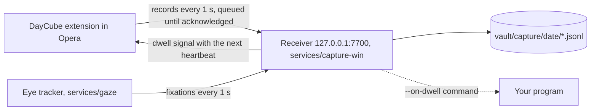

# Capture: browser and gaze on your PC

From sign-in to shutdown, three pieces record what you do in the browser and where you look:



- **The extension** reports pages, focus, searches, clicks, selections, media, and snapshots of
  the text on screen with where the viewport sits on the monitor.
- **The eye tracker** turns webcam frames into fixations with EyeTrax (MIT). Frames stay in
  memory; only fixations leave the process. It runs in its own environment because EyeTrax
  needs numpy<2 and the rest of DayCube needs numpy>=2.
- **The receiver** writes the logs, places each fixation on the paragraph under it, and detects
  dwells. It starts the eye tracker and restarts it if it stops.

Nothing goes over the network: the receiver listens on 127.0.0.1 only, and the extension can
reach no other host.

## Set up on Windows

From the repository folder, in PowerShell:

```powershell
uv sync --project services/capture-win
uv sync --project services/gaze

# 1. The webcam: frame rate and how often a face is found. Aim for 15+ frames/s and 90%+.
uv run --project services/gaze python -m gaze check

# 2. Calibrate: 13 dots, about 30 s. Sit as you normally do, about an arm's length away.
uv run --project services/gaze python -m gaze calibrate

# 3. Start everything now and at every sign-in (no administrator rights needed).
uv run --project services/capture-win python -m capture install-autostart
```

Then in Opera:

1. Open `opera://extensions`, turn on **Developer mode**, choose **Load unpacked** and pick the
   `extensions/chrome` folder.
2. On the extension's card, turn on **Allow access to search page results**. Opera keeps
   extensions off search result pages unless this is on.
3. Open the extension's options (right-click its toolbar button, then **Options**), paste the
   contents of `vault\.token`, tick **Record my browsing**, and save. The **Right now** panel
   should show the receiver and the eye tracker running.

Optional: copy the history Opera already kept (about 90 days) into the vault:

```powershell
uv run --project services/capture-win python -m capture import-history
```

Recalibrate when your seat, lighting or monitor changes (`python -m gaze calibrate`). It pauses
recording for the half minute it takes, which frees the webcam, and the receiver restarts the
tracker with the new calibration.

### Processing rate and live checks

The tracker now targets **30 processed frames/s** by default, including when started by the
receiver at sign-in. The camera keeps its existing mode: this setting does not request 1080p,
change calibration geometry or create a faster hardware capture mode. A manual override is:

```powershell
uv run --project services/gaze python -m gaze track --fps 15
```

`/status` reports `gaze.target_fps` separately from the rolling measured `gaze.fps` and face
detection fraction (`gaze.face`, from 0 to 1). Refresh the extension's options page after updating:
**Right now** shows measured/target FPS, face percentage and calibration error. For example,
`29.8/30 fps` means a measured 29.8 with a target of 30; it does not round the measurement up.
Pausing hides old active telemetry, and resuming waits for a fresh tracker report.

Collect a rate report without opening the camera, reading recordings or changing pause state:

```powershell
uv run python eval/profile_gaze.py --seconds 15 --output test-results/gaze-rate.json
```

The report samples status only. Its rate values share the tracker's rolling ten-second window,
so consecutive samples are correlated. Allow ten seconds after startup for that window to settle.
Processing rate and face detection establish that the tracker is working on frames; matched block
hits and the reading tests below are still needed to establish page placement and useful dwells.

## Everyday use

| To | Do |
| --- | --- |
| Pause everything, including the webcam | Click the toolbar button or press `Alt+Shift+D` (works once the token is saved, even with browser recording off). The badge reads `II`. The webcam is released within about a second |
| Resume | The same again. The badge reads `REC` |
| See whether it works | The extension's options page, **Right now**; or `http://127.0.0.1:7700/status` |
| Stop starting at sign-in | `python -m capture uninstall-autostart`, or turn it off in Task Manager > Startup apps |
| Read the logs | `vault\logs\capture.log` and `vault\logs\gaze.log` |

A pause is remembered across restarts: the receiver keeps it in `vault/capture/paused` until you
resume, and logs every pause and resume in `vault/capture/pauses.jsonl`. A pause made while the
receiver was unreachable is retried every 3 seconds for a minute, then every 30 seconds while
Opera is open. If Opera closes before the receiver hears of it, the pause applies at the next
start of Opera with the receiver running; until then the eye tracker keeps recording.

The webcam turns on only after the receiver has confirmed that it is running and not paused,
and turns off within about 5 seconds of the receiver stopping or a pause. It is also released,
and nothing is recorded, while the session is locked, while another app uses the camera (a
video call), and when you are away: no keyboard or mouse input for 5 minutes and no face for
the last minute. Reading without touching anything keeps tracking. When the primary monitor is
not the calibrated one (a laptop undocked, a monitor off), tracking stops and is retried every
minute.

## Dwells: when your eyes stay too long

A *dwell* is a run of fixations on one block of text (a paragraph, heading, list item or cell).
Glances away of up to 1 second do not end it; a gap in gaze of 2 seconds, a tab switch or a
navigation to another page does (an address change within the page, such as a section link,
does not). A run becomes a dwell when its fixation time reaches both:

- 8 seconds (`--dwell-seconds`), and
- twice the time the block takes to read at 238 words a minute (`--dwell-factor`), the average
  adult silent reading rate for English non-fiction (Brysbaert 2019, a meta-analysis of 190
  studies).

Reading a long paragraph at normal speed is therefore not a dwell. Reading it at under half
speed, re-reading it, or staring at a short line is.

Each dwell writes a `start` record when it is detected and an `end` record when it ends, with
the page, the block's text, fixation time and reading time. What happens at `start` is up to you:

| Action | Where to set it |
| --- | --- |
| Only record it (default) | Extension options |
| A notification with the passage | Extension options |
| A thin bar beside the paragraph, fading after 4 s. It is an element added to the page, so the site's scripts can see it | Extension options |
| Any program: it receives the dwell record as JSON on stdin | `python -m capture install-autostart --on-dwell "C:\path\to\program.exe --flag"` |

The bar and the notification arrive with the page's next heartbeat, so up to 5 seconds after
the dwell is detected. The program runs at once; one runs at a time.

## What is recorded

`vault/capture/<local date>/`, one JSON object per line:

| File | Records |
| --- | --- |
| `browser.jsonl` | `page` (address, how it was reached: link, typed, reload, form submit, back/forward; address changes that only move to a section are left out), `title`, `focus` (tab in front; none when the browser loses focus; no address for an excluded page), `idle` (active, idle after 60 s, locked), `search` (engine and query from result-page addresses), `click` (label, and the link address unless it points to an excluded domain), `selection` (selected or copied text), `media` (play, pause, end, with position) |
| `blocks.jsonl` | The text blocks on screen (up to 150) with their rectangles, and where the viewport is on the monitor. A block's text is sent once per page load, and again if queued text was dropped; later snapshots carry only positions |
| `gaze.jsonl` | Fixations as fractions of the monitor, with the page point and block each landed on |
| `attention.jsonl` | Dwell `start` and `end` records |
| `history.jsonl` | Visits imported from Opera's history |

Not recorded:

- private windows, and domains excluded in the extension options (subdomains included);
- the text, clicks, selections and media of a page while it, a frame in it (an embedded sign-in
  or payment form) or an open shadow root shows a password field. The page's address and title
  are still recorded;
- anything typed: fields, editable areas, and code editors that draw typed text in plain
  elements (Monaco, CodeMirror, Ace);
- anything while paused.

`import-history` leaves out the same things the extension would: the extension's excluded
domains (mirrored to `vault/capture/exclusions.json`), the domains, URL patterns and title
patterns in `services/capture-win/config/exclude.yaml`, and visits made while recording was
paused. It merges Opera Stable and Opera GX, and each run mirrors the browser's current history:
a day whose visits are all gone loses its file.

Every record has an id. The extension keeps records in its storage until the receiver
acknowledges them (up to 5,000; the oldest text snapshots are dropped first). The receiver
ignores an id it has already stored, and stores an id only once its record is written, so a
resend after a lost reply or a failed write is stored once per receiver run. Records older than
24 hours are refused. After a restart the receiver reloads block texts from today's and
yesterday's snapshots, so dwells on pages already open still know their text.

## How gaze is placed on a page

1. The tracker predicts a screen point per frame (EyeTrax ridge regression on MediaPipe eye
   landmarks), smooths it with a One Euro filter, and groups samples into fixations (I-DT,
   dispersion up to 6% of the screen width, at least 0.1 s, split at 1 s so a long stare is
   reported while it lasts).
2. The extension reports where the viewport is on the monitor: measured from two mouse events
   (screen point minus page point, and the page zoom from their spacing), otherwise estimated
   from the window's outer and inner sizes.
3. The receiver converts the fixation to page coordinates, corrects for scrolling since the last
   snapshot, and picks the block that contains it or lies within 40 CSS px.

## Limits

- **Accuracy.** Webcam gaze is good to roughly 3-4 degrees, about 150 px at 60 cm from a 24"
  monitor: paragraphs, not words. Calibration reports the median error on four held-out targets
  and refuses to track above 150 px (scaled to your screen width). Glasses, backlight and head
  movement make it worse; recalibrate when they change.
- **One monitor.** Gaze is calibrated on the primary monitor. Pages in windows on other monitors
  are recorded, but gaze is not placed on them.
- **Untested on your PC so far.** The receiver, extension and dwell path are tested end to end in
  Chromium on Linux (`npm run test:extension`), and the tracking loop with a scripted camera.
  Opera on Windows, the webcam, the sign-in entry, the lock, idle and camera-in-use checks, and
  the viewport estimate for your window layout have not run yet.
- **Browser only.** Other apps, screenshots and OCR are not captured yet; nor is there a tray
  icon. The toolbar badge and Windows' own camera indicator show that recording is on.
- **No synthesis yet.** The logs are not yet turned into day events in the viewer.

## Size

Estimates, not measurements: fixations are about 230 bytes each; at 2-4 a second over 8 hours of
screen time that is 13-27 MB a day before compression. Text snapshots depend on how much you
scroll. `daycube compact` compresses the capture logs of finished days with zstd, for days that
also have a vault day folder; capture-only days are not compacted yet.

## Tests

```powershell
uv run pytest services/ingest/tests/test_capture.py services/ingest/tests/test_attention.py services/ingest/tests/test_capture_tools.py
cd services/gaze; uv run pytest
npm run test:extension   # Node unit tests, then the extension in Chromium against a scratch vault
```
